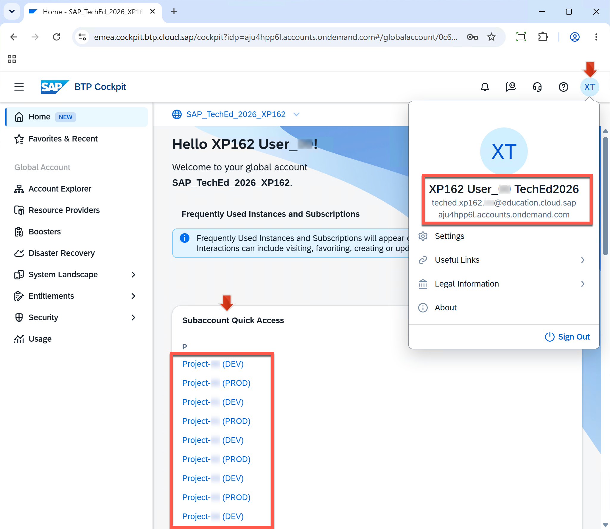
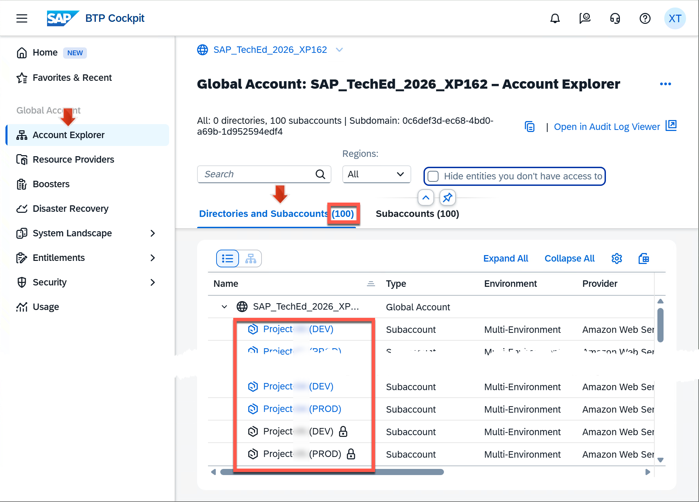
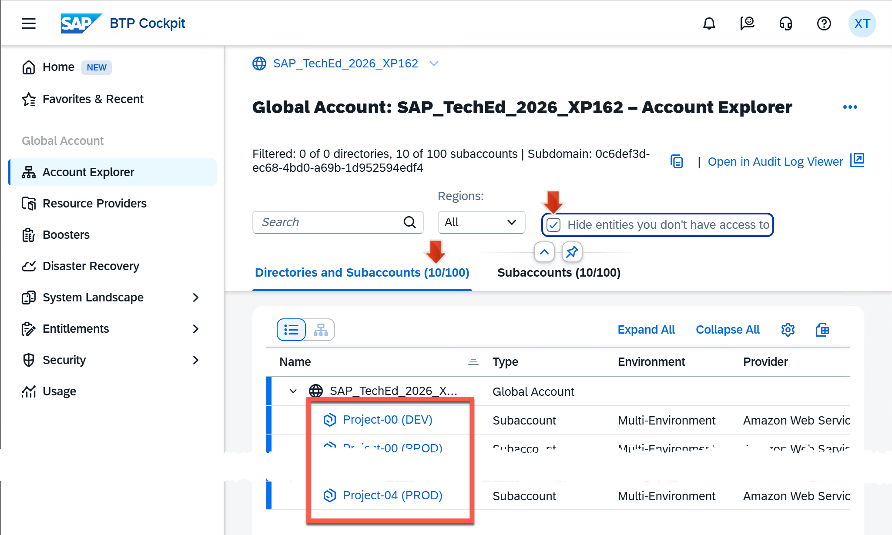
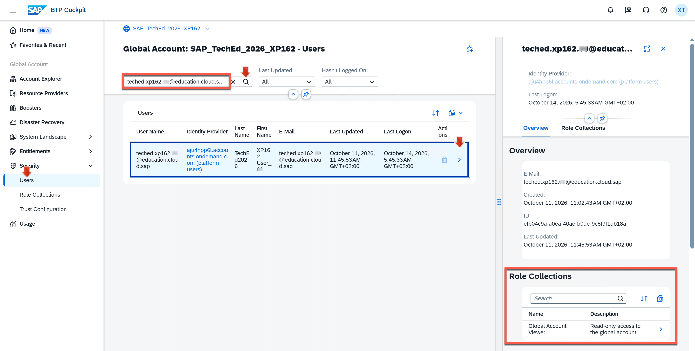
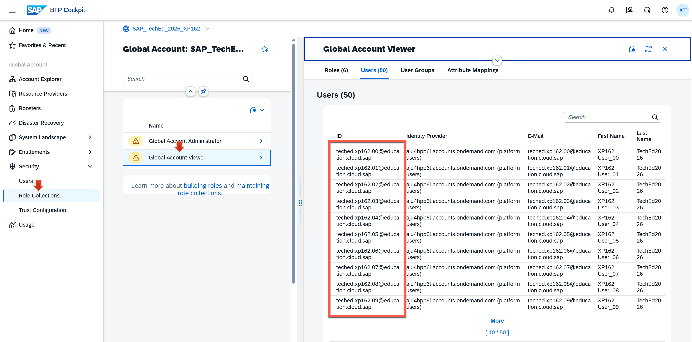
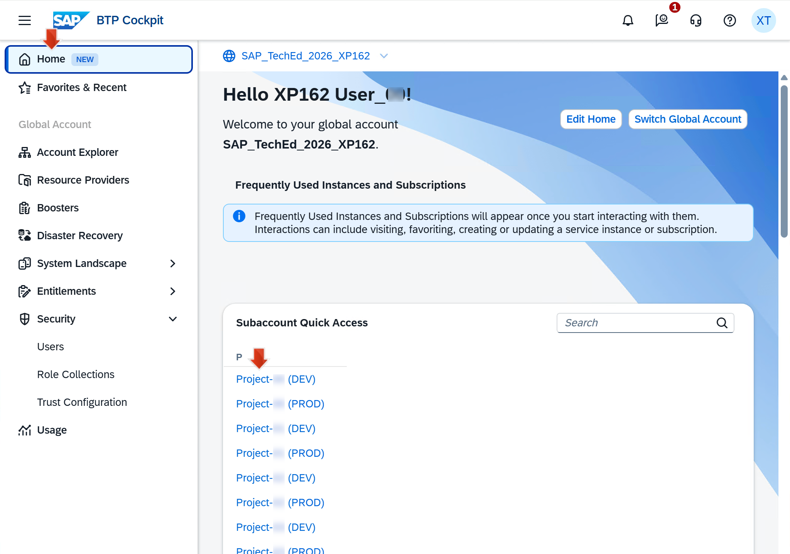
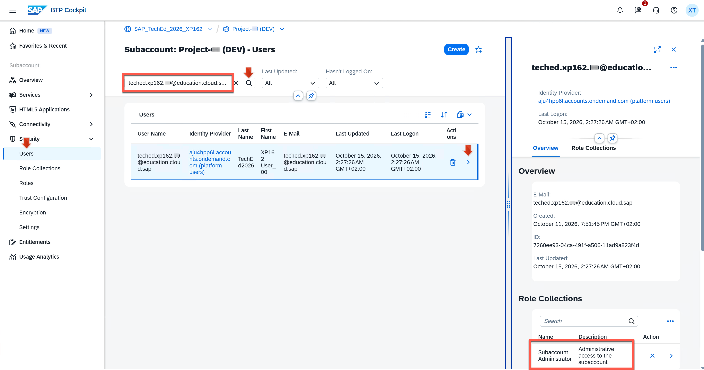

# Exercise 1 - Exploring BTP Accounts with BTP Cockpit

⏱️ **Estimated time**: 15-20 minutes

## Overview

Exercise 1 establishes the baseline: a test user (from a custom IdP) is assigned to a BTP global account and accesses it through BTP Cockpit.

In this exercise, you will explore your BTP Account to get an overview of where your user has access and which administrative tasks might be necessary to perform. You'll experience firsthand the time and effort required for basic information gathering using traditional UI navigation.

## Learning Objectives

By the end of this exercise, you will be able to:
- Navigate BTP Cockpit using custom IdP authentication
- Understand the difference between global account and subaccount permissions
- Identify your assigned role collections
- Recognize the limitations of manual cockpit navigation for administrative tasks

**This baseline experience is crucial** - it sets the context for understanding the transformation you'll experience in Exercise 2.

---

## Your Test User Credentials

You, XP162 session participant number `<NN>`, have received a BTP test user account:

📧 **Email**: `teched.xp162.<NN>@education.cloud.sap`  
🔑 **Password**: `xp162.<NN>...`  
🏢 **Identity Provider**: Custom IdP (`aju4hpp6l.accounts.ondemand.com`)  
👤 **Role**: Global Account Viewer

---

## 1. Open BTP Cockpit

1. Open **Google Chrome** Web browser

2. Launch the BTP Cockpit with custom IdP parameter:
   ```
   https://cockpit.btp.cloud.sap/?idp=aju4hpp6l.accounts.ondemand.com
   ```
   
   > [!NOTE]
   > The `?idp=` URL parameter specifies that you want to log into BTP Cockpit as a user from the custom Identity Provider `aju4hpp6l.accounts.ondemand.com`

3. Enter your test user **email** and **password** and press **`Log On`**

   ✅ **Expected Result**: The BTP Cockpit homepage opens.
   
   

   **What you see:**
   - Your test user XP162 User_`<NN>` from custom IdP is logged in (see user menu in top-right corner)
   - Your user has access to 10 subaccounts starting with Project-`<numbers>`
   - These are shown in the `Subaccount Quick Access` home card

---

## 2. Explore the Account Structure

4. Click on **`Account Explorer`** in the left navigation

   

   ✅ **Expected Result**: Here you see that:
   - Your user has a list of **100 subaccounts total**
   - **10 of them are accessible** with clickable links (these correspond to the ones shown in `Subaccount Quick Access`)
   - **90 of them are not accessible** for your user (indicated by lock icons 🔒)

5. You can select **`Hide entities you don't have access to`** filter to show only your 10 accessible subaccounts
   
   

---

## 3. Explore Global Account Permissions

Now explore which permissions your user has at the global account level.

6. Click on **`Security > Users`** in the left navigation

   

   ✅ **Expected Result**: Here you see:
   - The list of users defined at global account level
   - When scrolling down: 50 test users (`teched.xp162.00@education.cloud.sap` to `teched.xp162.49@education.cloud.sap`) for all XP162 session participants
   - Additional users from the session owner

7. Use the **search filter** to find your user `teched.xp162.<NN>@education.cloud.sap`

8. Click on your user in the search results

   ✅ **Expected Result**: Your user details show that you are assigned to the **`Global Account Viewer`** role collection

9. Click on **`Security > Role Collections`** in the left navigation

10. Select **`Global Account Viewer`** from the list

    

    ✅ **Expected Result**: Here you see:
    - All hands-on users (ID/E-Mail type `teched.xp162.<NN>@education.cloud.sap`) have only **Viewer access** to the Global Account
    - This is a read-only role with limited privileges

    > 💡 **Key Insight**: A global account administrator has granted your test user access to 10 subaccounts. However, you only have viewer permissions at the global account level.

---

## 4. Explore Subaccount Permissions

To explore what you can do in your accessible subaccounts, you have to navigate into each of them individually to check:
- Which permissions you have there
- Which other users are assigned
- What services quota is assigned
- What subscriptions exist

**This is tedious work.** For this exercise, we'll explore just one subaccount to understand the process.

### 4.1 Navigate to a Specific Subaccount

11. Click on **`Home`** in the left navigation

12. On the **`Subaccount Quick Access`** home card, find the subaccount link **`Project-<NN> (DEV)`**

13. Click on the **`Project-<NN> (DEV)`** link to navigate into this subaccount

    

### 4.2 Check Your Permissions in the Subaccount

14. In the subaccount, click on **`Security > Users`**

15. Use the search to find your user **`teched.xp162.<NN>@education.cloud.sap`**

16. Click on your user entry to open the user details page

    

    ✅ **Expected Result**: Here you see:
    - In subaccount `Project-<NN> (DEV)`, your user is assigned to the **Subaccount Administrator** role
    - Your user is allowed to perform typical subaccount administrator tasks:
      - Adding users and assigning roles
      - Creating services and subscriptions (if entitled)
      - Managing subaccount configurations

    > 💡 **Note**: To get information about your other accessible subaccounts (which permissions you have, which other users are defined), you must navigate back and forth between multiple pages. There's no aggregated view.

---

## 5. Understanding Your Complete Access

If you continued to explore your remaining 9 accessible subaccounts (we won't do this to save time), you would eventually discover that your user `teched.xp162.<NN>@education.cloud.sap`:

1. Is **Subaccount Administrator** in **2 subaccounts**:
   - `Project-<NN> (DEV)`
   - `Project-<NN> (PROD)`

2. Is **Subaccount Viewer** in the **other 8 subaccounts**

**Time investment to discover this**: ~10 minutes of manual navigation through each subaccount.

---

## 6. The Challenge: Inefficient Administrative Tasks

In the role of a subaccount administrator or viewer managing several subaccounts, you frequently need information about users, services, runtime environments, etc.

### Common Administrative Questions

As a BTP account administrator, you might need answers to questions like:

1. 📊 **User Management**: "Which users exist in my subaccounts and which permissions (role collections) do they have?"
2. 👤 **Inactive Users**: "Which users exist and have never logged in?"
3. 🔧 **Subscriptions**: "Which active subscriptions are entitled in my accessible subaccounts?"
4. ☁️ **Runtime Environments**: "Which of my subaccounts have a Cloud Foundry runtime environment?"

### The Problem

While all these questions *could* be answered using BTP Cockpit, it's highly inefficient:

**Example: Finding inactive users**
- Navigate to each subaccount (10 subaccounts)
- For each: Security → Users → Check each user's last login
- Manually note down results
- **Time required**: 15-20 minutes
- **Error-prone**: Easy to miss users or make mistakes while copying data

**Example: Checking which permissions you have across subaccounts**
- Navigate to each subaccount
- Security → Users → Search for your user → Check role collections
- Remember or write down the results
- **Time required**: 10 minutes
- **Result**: You just did this in Exercise 1!

### The Solution

**There is a better way!**

In **Exercise 2**, you'll use the **MCP Server for BTP Administration** with **Claude Code CLI** to answer these same questions:
- Single natural language prompts instead of multiple navigation steps
- Comprehensive answers in seconds instead of minutes
- Aggregated views across all your subaccounts at once

---

## ✓ Validation Checklist

You have successfully completed this exercise if you can answer:

- [ ] What is your role at the global account level?  
  *(Answer: Global Account Viewer - read-only access)*

- [ ] In how many subaccounts are you a Subaccount Administrator?  
  *(Answer: 2 subaccounts - the DEV and PROD subaccounts for your number)*

- [ ] What is the total number of subaccounts in the global account?  
  *(Answer: 100 subaccounts total)*

- [ ] How many subaccounts do you have access to?  
  *(Answer: 10 accessible subaccounts)*

- [ ] How long did it take to find your permissions in one subaccount?  
  *(Answer: ~5 minutes of navigation)*

---

## Troubleshooting

| Issue | Solution |
|-------|----------|
| **Can't see 10 subaccounts** | Check filter settings - ensure "Hide entities you don't have access to" is not enabled when you first open Account Explorer |
| **Login fails** | Verify you're using the correct `<NN>` number in both email and password |
| **Screenshots don't match exactly** | UI may have minor updates; follow the navigation paths described in the text rather than matching screenshots exactly |
| **Can't find Project-`<NN>` (DEV)** | Use the search function in the Subaccount Quick Access card, or scroll through the list |
| **Wrong Identity Provider** | Ensure you're using the URL with `?idp=aju4hpp6l.accounts.ondemand.com` parameter |

---

## Summary

**What You Accomplished:**

In this exercise, you:
1. ✅ Logged into BTP Cockpit with a custom IdP user
2. ✅ Explored the account structure (100 subaccounts, 10 accessible)
3. ✅ Discovered your global account role (Global Account Viewer)
4. ✅ Navigated into a specific subaccount
5. ✅ Found your subaccount-level permissions (Administrator in some, Viewer in others)

**Key Takeaways:**

📊 **Information is fragmented**: User permissions, subaccount details, and service information are spread across multiple pages and levels

⏱️ **Time-consuming**: Even simple questions require extensive navigation (5-10 minutes per query)

🔄 **Repetitive**: You must repeat the same navigation steps for each subaccount or user

📝 **Manual note-taking required**: No aggregated views mean you must manually compile information

❌ **Error-prone**: Easy to miss details or make mistakes during manual data collection

---

## What's Next?

In **Exercise 2**, you'll experience the transformation:
- Set up Claude Code CLI with BTP MCP
- Ask the **same questions** you struggled with here
- Get comprehensive answers in **10 seconds instead of 10 minutes**
- See aggregated data across all your subaccounts at once

**The baseline is established. Now let's see what's possible with AI.**

Continue to - [Exercise 2 - Using BTP MCP Server with Claude Code CLI](../ex2/README.md)
