# Exercise 2 - Using BTP MCP Server with Claude Code CLI

⏱️ **Estimated time**: 30-35 minutes

## Overview

In Exercise 1, you experienced the limitations of using BTP Cockpit - navigating back and forth between pages to gather information took 10-15 minutes and was highly inefficient.

**Now experience the transformation.**

In this exercise, you'll use the **MCP Server for SAP BTP Administration** with **Claude Code CLI** to answer the same administrative questions — but in seconds instead of minutes, using natural language instead of clicking.

## Learning Objectives

By the end of this exercise, you will be able to:
- Configure and authenticate the BTP MCP Server in Claude Code CLI
- Understand the MCP architecture and authentication flow
- Use natural language prompts to query BTP account information
- Manage tool permissions in Claude Code
- Experience 10x efficiency gains compared to Exercise 1

---

## What is MCP?

**Model Context Protocol (MCP)** is an open protocol that standardizes how applications provide context to Large Language Models (LLMs).

The **MCP Server for SAP BTP Administration** exposes **58+ tools** that allow Claude Code to:
- List and manage BTP accounts, subaccounts, and directories
- Query and manage users, roles, and role collections
- Retrieve information about services, subscriptions, and destinations
- Perform administrative operations on your behalf

This makes Claude Code an intelligent assistant that can interact with your BTP landscape using natural language.

---

## 1. Open PowerShell Terminal

1. Click **`Start`** button on the Windows taskbar and search for **`Terminal`**

2. Right-click on **`Terminal App`** and choose **`Run as administrator`**

3. If `User Access Control` dialog opens, confirm with **Yes**

   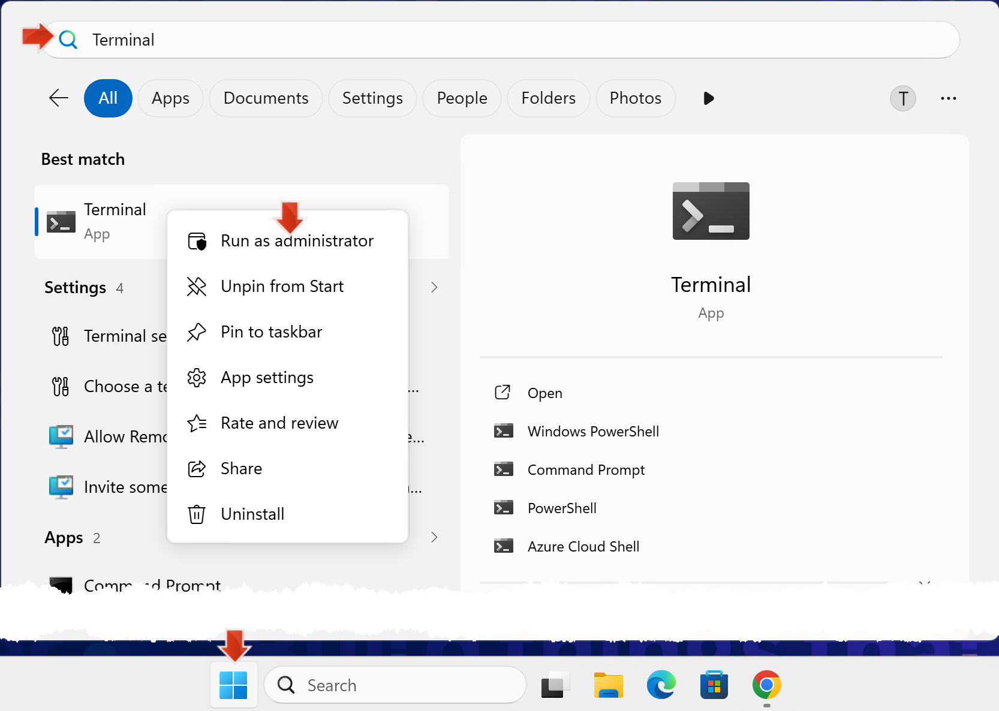

   ✅ **Expected Result**: An Administrator PowerShell Terminal window opens.

> [!NOTE]
> For each command in the terminal, press the return key ⏎ to execute it.

4. Create a project folder:
   ```powershell
   mkdir MyFirstBtpMcpProject
   ```

5. Navigate into the folder:
   ```powershell
   cd MyFirstBtpMcpProject
   ```

---

## 2. Launch Claude Code CLI

1. Open Claude Code CLI:
   ```powershell
   claude
   ```

2. Press **`Enter`** ⏎ to confirm default text style (if Claude asks)

3. Read the two security notes and press **`Enter`** ⏎ to continue

4. Press **`Enter`** ⏎ again to confirm *Yes, I trust this folder*

   ✅ **Expected Result**: The Claude Code CLI interface is ready to take your first prompt.

   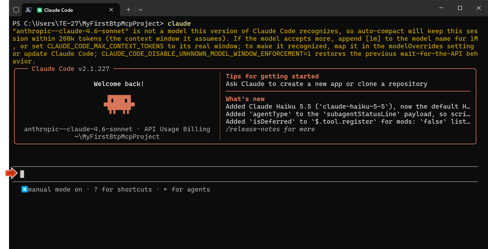

---

## 3. Configure BTP MCP Server

Before using the BTP MCP server, you need to:
1. Add the MCP configuration
2. Set up authentication credentials

We'll use VS Code to visualize the configuration.

### 3.1 Open VS Code

1. Type **`exit`** and press **`Enter`** ⏎ to leave Claude:
   ```
   exit
   ```

2. Clean up Terminal output:
   ```powershell
   clear
   ```

3. Open VS Code in the current folder:
   ```powershell
   code .
   ```

   ✅ **Expected Result**: VS Code opens showing your empty project folder.

   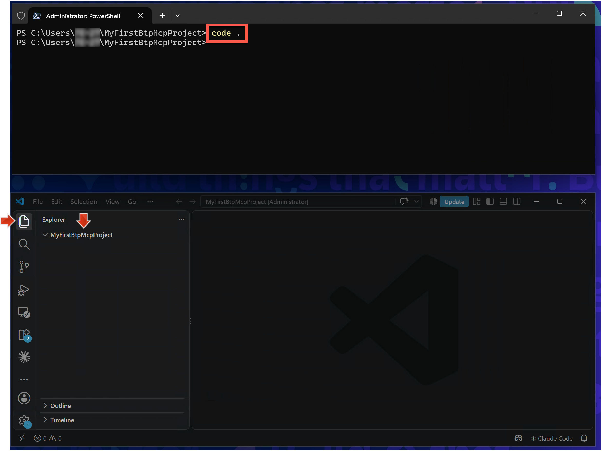

   💡 **Tip**: Place VS Code next to the Terminal window for easy switching.

### 3.2 Add MCP Configuration

4. Run this command in PowerShell to add the BTP MCP configuration:

   ```powershell
   claude mcp add --transport http --scope project mcp-btp-admin-customidp "https://proxy.c-769d49e.kyma.ondemand.com/mcp" --header 'Authorization: Basic ${BTP_CREDENTIALS}' --header 'X-Platform-Origin: ${BTP_ORIGIN}'
   ```

   ✅ **Expected Result**: A `.mcp.json` file appears in your project folder (visible in VS Code).

   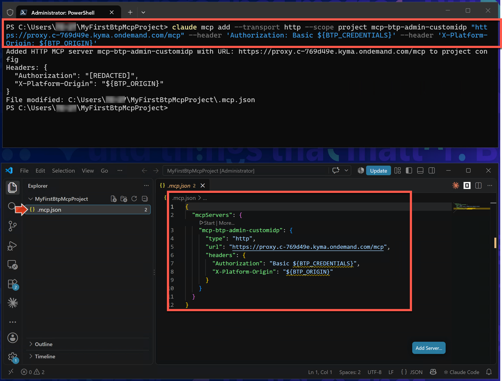

   **What this does:**
   - Creates an MCP server configuration named `mcp-btp-admin-customidp`
   - Points to the BTP MCP server URL
   - Configures authentication to use environment variables `${BTP_CREDENTIALS}` and `${BTP_ORIGIN}`

### 3.3 Set Authentication Credentials

Now you'll store your BTP credentials as environment variables.

5. Store your BTP credentials:

   > [!CAUTION]
   > **Be very precise with email and password!** A password typo could lock your account after several failed attempts.

   **Template** (don't run this - see example below):
   ```powershell
   $Env:BTP_CREDENTIALS = [Convert]::ToBase64String([Text.Encoding]::UTF8.GetBytes('<YOUR-TEST-USER-EMAIL>:<YOUR-TEST-USER-PASSWORD>'))
   ```

   **Example with your credentials** (adapt to your `<NN>`):
   ```powershell
   $Env:BTP_CREDENTIALS = [Convert]::ToBase64String([Text.Encoding]::UTF8.GetBytes('teched.xp162.00@education.cloud.sap:xp162.00xyAcce$$'))
   ```

   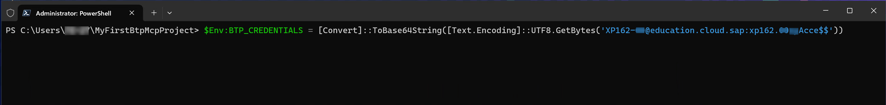

6. Store the custom IdP origin:
   ```powershell
   $Env:BTP_ORIGIN = 'aju4hpp6l'
   ```

   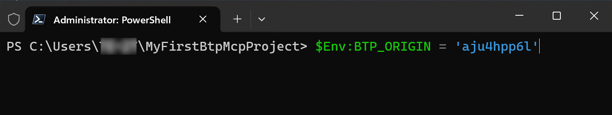

   ✅ **Checkpoint**: Environment variables are set. You're ready to authenticate!

---

## 4. Verify BTP MCP Connection

1. Launch Claude Code CLI again:
   ```powershell
   claude
   ```

2. Confirm **`Use this MCP Server`** with **`Enter`** ⏎

3. Open the MCP management menu:
   ```
   /mcp
   ```

   > 💡 **Tip**: In Claude Code, slash commands (like `/mcp`) are shortcuts to specific actions.

   ✅ **Expected Result**: The `mcp-btp-admin-customidp` MCP server is listed as **connected** with 58 tools.

   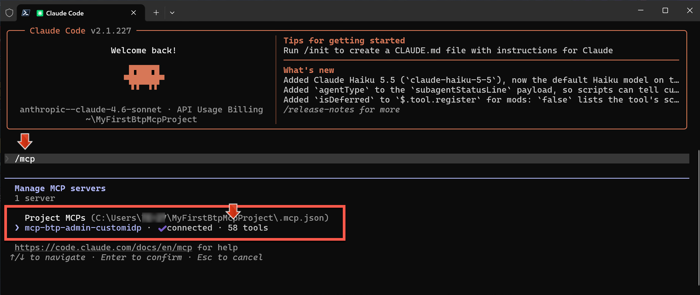

   > 🔧 **Troubleshooting**: If the MCP shows "Not connected", verify your `BTP_CREDENTIALS` and `BTP_ORIGIN` environment variables. Test your credentials by logging into BTP Cockpit first.

4. Press **`Enter`** ⏎ with the MCP server selected to see details

   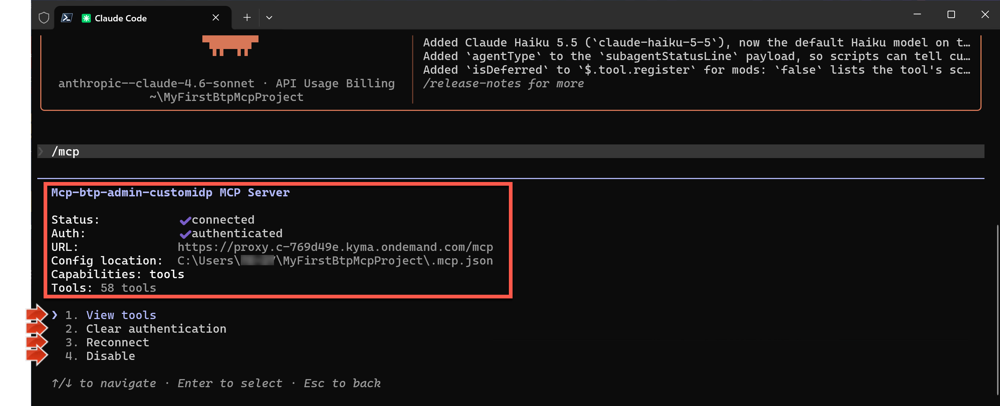

   **Verify:**
   - ✅ Status: Connected
   - ✅ Auth: authenticated
   - ✅ Tools: 58 available

### 4.1 Explore Available Tools

5. Select **`View tools`** and press **`Enter`** ⏎

   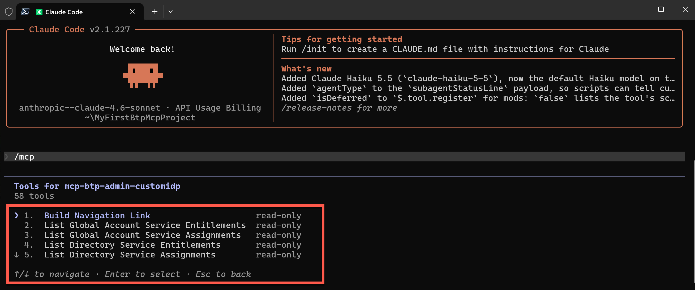

   **Tool Categories:**
   - **accounts**: List Global Accounts, Create Subaccounts, etc.
   - **security**: List Users, Create Role Collections, etc.
   - **services**: List Subscriptions, Create Service Instances, etc.
   - **connectivity**: List Destinations, Create Destinations, etc.

6. Press **`Esc`** several times to exit the MCP menu

   ✅ **Expected Result**: Claude Code CLI shows "MCP dialog dismissed" and is ready for prompts.

   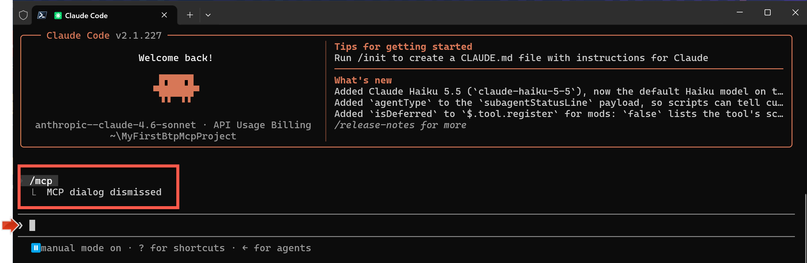

---

## 5. Query Your BTP Account with Natural Language

Now the transformation begins! You'll ask the same questions from Exercise 1, but using natural language.

### Query 1: Find Your Global Account

1. Copy and paste this prompt into Claude Code:
   ```
   Which Global Account I'm assigned to and what is the Cockpit URL?
   ```

   Claude will ask permission to use tools. This is **manual mode** - you approve which tools Claude can use.

2. Select **`Yes, and don't ask again...`** for the `List Global Accounts` tool

   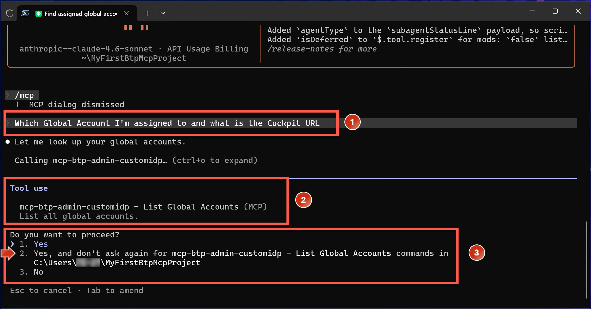

   **Why approve?**
   - This is a read-only tool (safe to use repeatedly)
   - "Don't ask again" saves time for future calls
   - Permissions are stored in `./.claude/settings.local.json`

3. Also approve **`Build Navigation Link`** tool with **`Yes, and don't ask again...`**

   ✅ **Expected Result**: Claude shows your Global Account name and provides a Cockpit URL.

   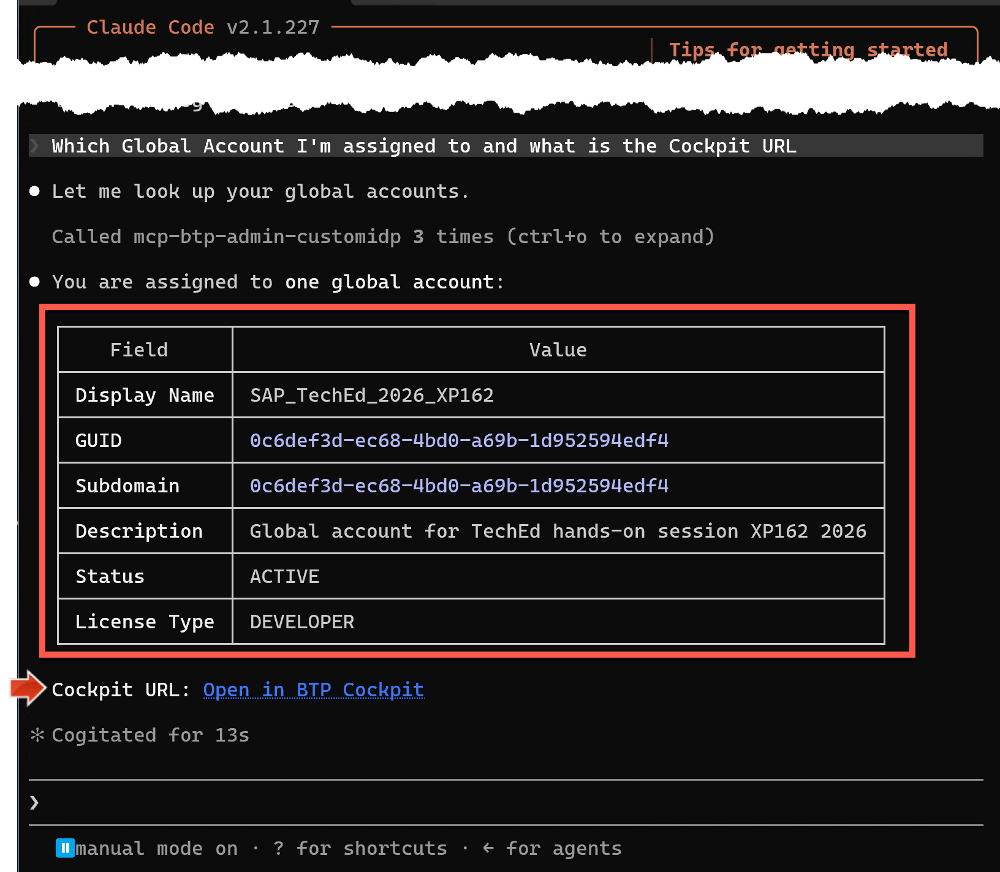

4. **`Ctrl + Click`** on the Cockpit URL link

5. Sign in with your test user if needed

   ✅ **Expected Result**: BTP Cockpit opens to your global account home page.

   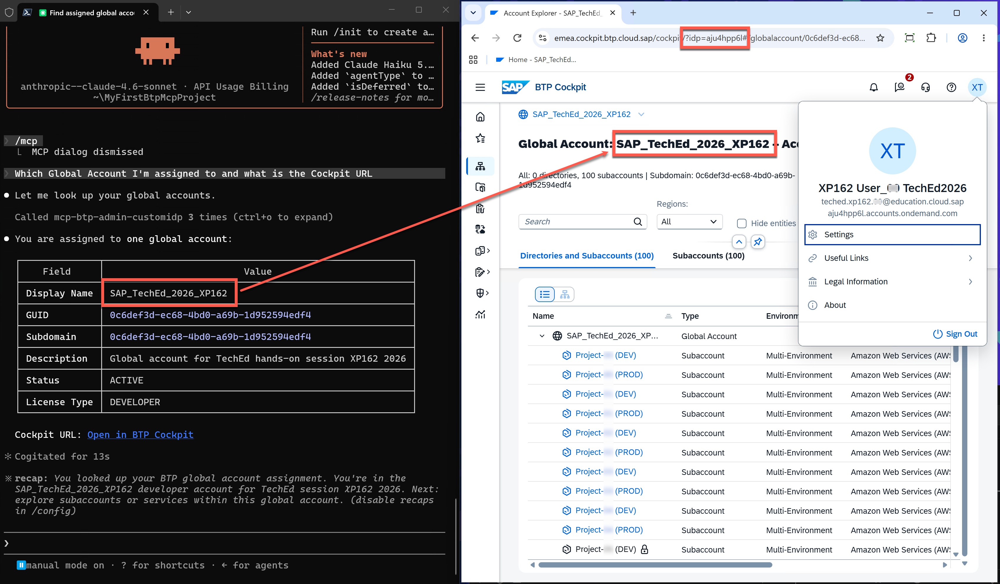

   > 💡 **Setup Tip**: Place the Browser window next to your Claude window so you can verify results side-by-side.

---

### Query 2: Find Your Permissions (The Same Task from Exercise 1!)

Remember in Exercise 1 how you had to navigate through multiple subaccounts to find your permissions? Let's see how long it takes now.

6. Copy and paste this prompt (replace `<NN>` with your number):
   ```
   Check BTP user teched.xp162.<NN>@education.cloud.sap from aju4hpp6l custom IdP: List Global Account and Subaccount role permissions for this user and provide subaccount links where user has access to.
   ```

7. Approve any read-only tools Claude needs with **`Yes, and don't ask again...`**

   ✅ **Expected Result**: Claude provides a comprehensive answer showing:
   1. Your Global Account role (Viewer)
   2. Your 2 subaccounts where you're Administrator
   3. Your 8 subaccounts where you're Viewer
   4. Clickable links to each subaccount

   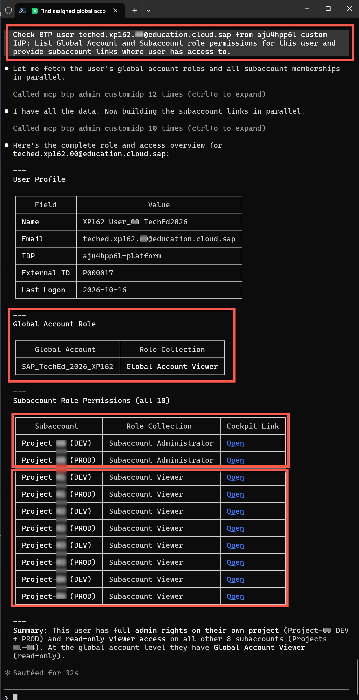

   **Compare with Exercise 1:**
   - **Exercise 1**: ~10 minutes of manual navigation
   - **Exercise 2**: ~10 seconds with one prompt
   - **Efficiency gain**: 60x faster! ⚡

---

## 6. Try More Administrative Queries

Now experiment with the other questions from Exercise 1!

### User Management

8. Copy and paste:
   ```
   Which users exist in my accessible subaccounts and which permissions do they have?
   ```

   Approve read-only tools as needed.

   ✅ **Expected Result**: Comprehensive overview of all users and their permissions across your 10 subaccounts.

### Inactive Users

9. Copy and paste:
   ```
   Which users exist in which of my subaccounts and have never logged in? Create subaccount links which navigate to subaccount users UI
   ```

   ✅ **Expected Result**: List of users who never logged in, organized by subaccount, with direct links to manage them.

   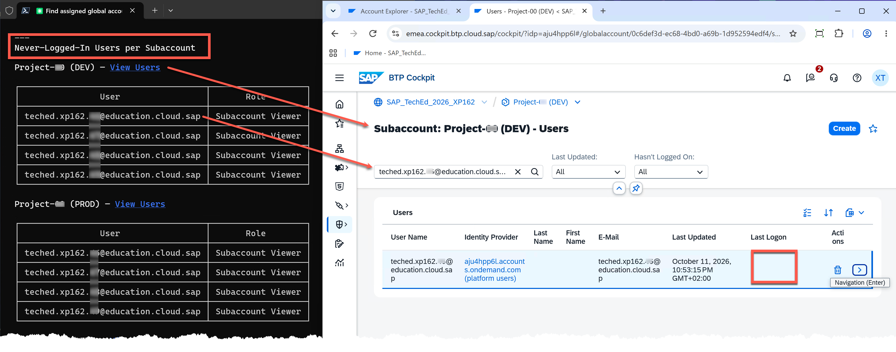

   **In Exercise 1**, this would require:
   - Navigating to each of 10 subaccounts
   - Checking each user's last login date
   - Manually noting down the results
   - **Time**: 15-20 minutes

   **In Exercise 2**: One prompt, ~15 seconds ⚡

### Runtime Environments

10. Copy and paste:
    ```
    Which of my subaccounts have a Cloud Foundry runtime environment?
    ```

    ✅ **Expected Result**: List of subaccounts with Cloud Foundry, including org names and API endpoints.

---

## ✓ Validation Checklist

You have successfully completed this exercise if you can:

- [ ] Configure and authenticate BTP MCP Server in Claude Code CLI
- [ ] View the 58 available MCP tools in the `/mcp` menu
- [ ] Use natural language prompts to query BTP information
- [ ] Understand tool permission management
- [ ] Retrieve user permissions in 10 seconds (vs. 10 minutes in Exercise 1)
- [ ] Answer administrative questions across multiple subaccounts instantly

---

## Troubleshooting

| Issue | Solution |
|-------|----------|
| **MCP shows "Not connected"** | Check `BTP_CREDENTIALS` and `BTP_ORIGIN` environment variables. Test credentials at BTP Cockpit first. |
| **"Permission denied" errors** | Ensure PowerShell is running as Administrator |
| **Environment variables not found** | Re-run the `$Env:BTP_CREDENTIALS` and `$Env:BTP_ORIGIN` commands. Note: These are session-specific. |
| **Claude asks permission repeatedly** | Check `./.claude/settings.local.json` - permissions should be saved there |
| **Wrong Global Account** | Verify you're using the correct test user from Exercise 1 |
| **VS Code doesn't open** | Use full path: `"C:\Program Files\Microsoft VS Code\Code.exe" .` |

---

## Summary

**What You Accomplished:**

1. ✅ Configured BTP MCP Server with Basic Authentication
2. ✅ Authenticated using environment variables
3. ✅ Explored 58 administrative tools across 4 domains
4. ✅ Retrieved information using natural language prompts
5. ✅ Experienced **10-60x efficiency gains** compared to Exercise 1

**The Transformation in Numbers:**

| Task | Exercise 1 (Cockpit) | Exercise 2 (MCP) | Improvement |
|------|---------------------|------------------|-------------|
| **Find user permissions** | ~10 minutes | ~10 seconds | **60x faster** |
| **Identify inactive users** | ~15 minutes | ~15 seconds | **60x faster** |
| **List runtime environments** | ~5 minutes | ~10 seconds | **30x faster** |

**Key Insight:**
Single prompts replaced multi-step navigation. Aggregated data came from all subaccounts at once. Tasks that took minutes now take seconds.

---

## What's Next?

So far you've used **read-only queries** with a **Viewer** user.

In **Exercise 3**, you'll switch to a **Global Account Administrator** user and experience complex **write operations** through BTP Cockpit (creating subscriptions, assigning roles). You'll see how even with administrator privileges, workflows remain complex and time-consuming in the UI.

Then in **Exercise 4**, you'll perform these same workflows with BTP MCP - transforming 30+ manual steps into single prompts.

**The transformation continues...**

Continue to - [Exercise 3 - Exploring Administrator Capabilities with BTP Cockpit](../ex3/README.md)
