# Exercise 3: Exploring Global Account Administrator Capabilities with BTP Cockpit

⏱️ **Estimated time**: 10-15 minutes

## Overview

Exercise 3 establishes the baseline for performing **administrative write operations** in BTP. You'll use a second test user with **Global Account Administrator** privileges to explore capabilities beyond read-only queries.

In Exercise 1, you experienced the limitations of being a viewer. Now you'll see what's possible as an administrator — but you'll still face the same challenge: performing these tasks through BTP Cockpit requires many navigation steps and manual actions.

**What You'll Learn:**
- The difference between viewer and administrator permissions
- How to grant yourself subaccount access as a Global Account Administrator
- The multi-step process for assigning service quotas and creating subscriptions
- The complexity of role assignments for application access

This exercise sets the stage for **Exercise 4**, where you'll perform these same administrative tasks using BTP MCP — transforming 20+ manual steps into simple natural language prompts.

---

## Prerequisites

- Completed Exercise 1 and Exercise 2
- Google Chrome browser
- Your second test user credentials:
  - 📧 **Email**: `jens.glander+teched.edu.<NN>@sap.com`
  - 🔑 **Password**: `xp162.<NN>***`

## Learning Objectives

By the end of this exercise, you will be able to:
- Understand Global Account Administrator privileges and capabilities
- Navigate the multi-step process for service subscription creation in BTP Cockpit
- Assign yourself as administrator to previously inaccessible subaccounts
- Configure role collections for application access
- Recognize the complexity and time investment required for administrative workflows in the UI

---

# Use BTP Cockpit to Explore a BTP Account

## About Your Second Test User

You, XP162 session participant number `<NN>`, have received a **second** BTP test user account with **different permissions**:

📧 **Email**: `jens.glander+teched.edu.<NN>@sap.com`  
🔑 **Password**: `xp162.<NN>***`  
🏢 **Identity Provider**: SAP ID Service (default IdP, not custom)  
👤 **Role**: **Global Account Administrator** (not just Viewer!)

### Key Differences from Exercise 1

| Aspect | Exercise 1 User | Exercise 3 User (This) |
|--------|-----------------|------------------------|
| **Identity Provider** | Custom IdP (aju4hpp6l) | SAP ID Service (default) |
| **Global Account Role** | SAP_TechEd_2026_XP162 (one for all users) | **SAP_TechEd_2026_XP162_&lt;NN&gt;** (one for each user) |
| **Global Account Role** | Global Account Viewer | **Global Account Administrator** |
| **Subaccount Access** | 10 accessible, 90 locked | 5 accessible, 5 locked (initially) |
| **Capabilities** | Read-only queries | **Full administrative operations** |

> 💡 **Why Two Users?** This simulates a realistic enterprise scenario where you might have different accounts with different privilege levels across various BTP landscapes.

---

## 1. Open BTP Cockpit

1. Open Google Chrome Web browser

2. Launch https://cockpit.btp.cloud.sap
   
> [!NOTE]
> Notice: No `?idp=` parameter this time! This user authenticates via the default SAP ID Service, not a custom IdP.

   ✅ **Expected Result**: SAP ID `Sign In` page opens.

   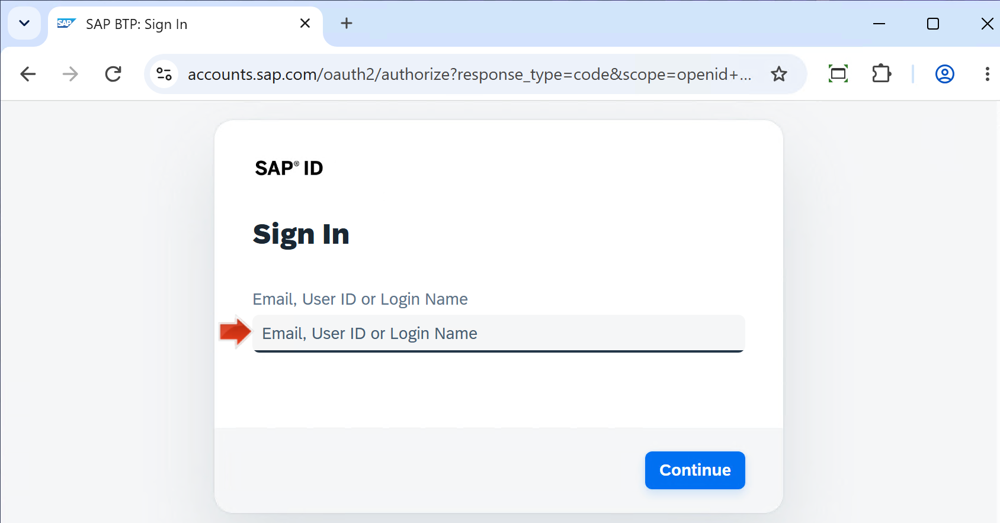

3. Enter your test user **email** and press `Continue`

4. Enter your **password** and press `Log On`

   ✅ **Expected Result**: The BTP Cockpit homepage opens.

   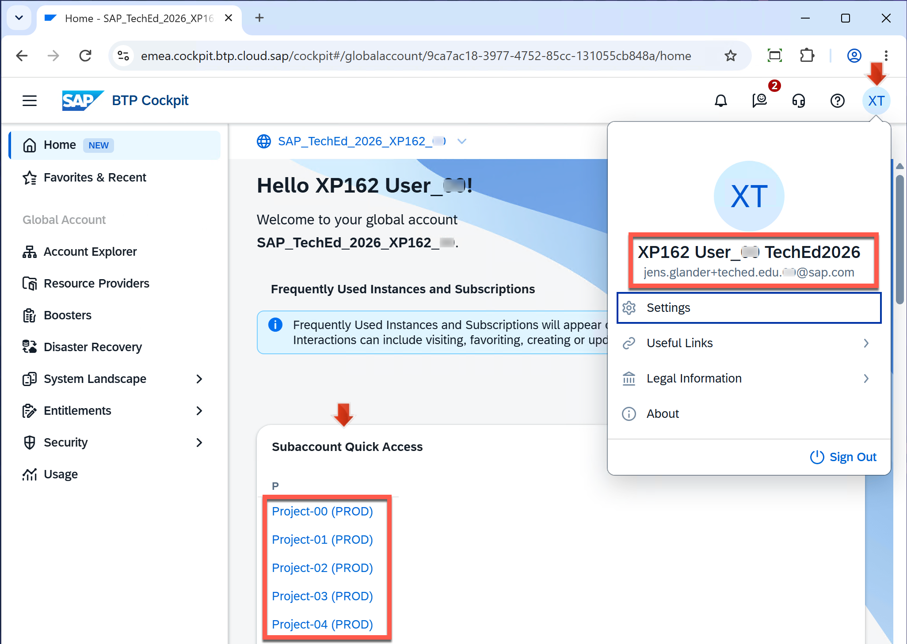

   Here you see that:
   - Your test user XP162 User_`<NN>` from SAP ID default Identity Provider is logged in (see open user menu in the top-right corner of the screenshot)
   - Your user has access to **5 subaccounts** starting with Project-`<numbers>` and clicking on a link would navigate there (see `Subaccount Quick Access` home card in the screenshot)

---

## 2. Explore the Account Structure

> [!NOTE]
> **Continue with your open Chrome browser** where you have [BTP Cockpit](https://cockpit.btp.cloud.sap) already logged in with your SAP ID test user.

1. Click on `Account Explorer`

   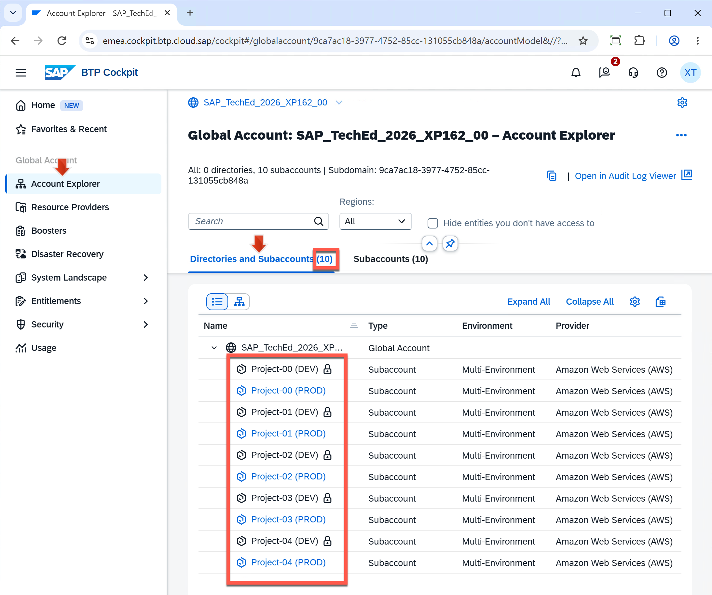

   ✅ **Expected Result**: Here you see that:
   - Your user has a list of **10 subaccounts total**
     - **5 of them are accessible** with link to navigate into it (these correspond to the ones displayed before in `Subaccount Quick Access` home card)
     - **5 of them are not accessible** for your user (see lock icons)
   - You could also select `Hide entities you don't have access to` filter to get only your 5 accessible subaccounts displayed

   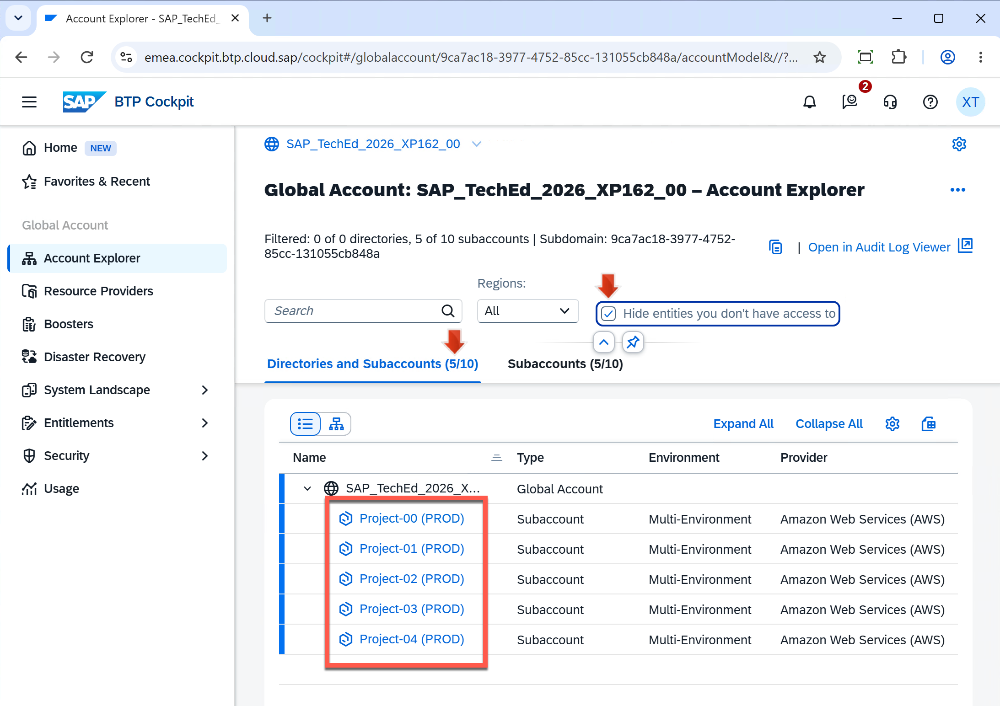

---

## 3. Explore Global Account Permissions

Explore further which permissions your user has on global account level.

5. Click on `Security > Users`

   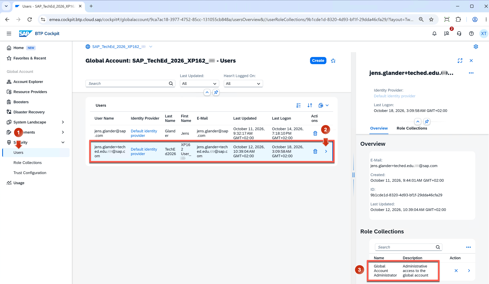

   ✅ **Expected Result**: Here you see:
   - The list of users defined on global account level. Only **two users** exist on global account level:
     - Your test user `jens.glander+teched.edu.<NN>@sap.com` (selected in screenshot)
     - `jens.glander@sap.com` (TechEd session XP162 owner)
   - Click on your user row to show more user details; e.g., your user is assigned to **`Global Account Administrator`** role collection

   > 💡 **Key Insight**: Your BTP test user has **Administrator access** to this BTP global account and is allowed to perform administrative tasks like:
   > 
   > - ✅ Assign yourself to non-accessible subaccounts as subaccount administrator, so that you get subaccount access
   > - ✅ Assign service quotas to any subaccount (which can be used then to create service subscriptions there)
   > - ✅ Create and manage role collections

These are just few examples of administrative tasks which you will perform using BTP MCP in next exercise 4.

Before describing how to use MCP to do that, we first walk through these example administrative tasks in the BTP Cockpit so you can appreciate the efficiency gains in exercise 4.

---

## 4. Explore Administrative Information of Accessible and Non-Accessible Subaccounts

You learned already in Exercise 1 how to explore your accessible subaccounts with BTP Cockpit: you navigate into each of them, looking for Role Collection (with respective access permissions) your user is assigned there, which other users exist there, if you have services entitlements available for assigning to subaccounts, etc.

- If you would do that, you would for example find out that you are **Subaccount Administrator** in all 5 of your accessible subaccounts of type `Project-<DD> (PROD)`

### The Challenge: How Do You Explore Non-Accessible Subaccounts?

**As a Global Account Administrator, you have the capability to grant yourself access!**

**Task: Explore for one of your 5 non-accessible subaccounts which users with permissions are defined there.**

### 4.1 Grant Yourself Subaccount Administrator Access

1. Click on `Account Explorer`

2. Open for the **first non-accessible** (lock icon) subaccount the `Actions` menu by clicking on `...` at the end of the subaccount row

3. Choose option **`Add me as Admin`**

4. Click **`Assign`** on the opened `Assign Me as Subaccount Administrator` dialog to confirm the selected action

   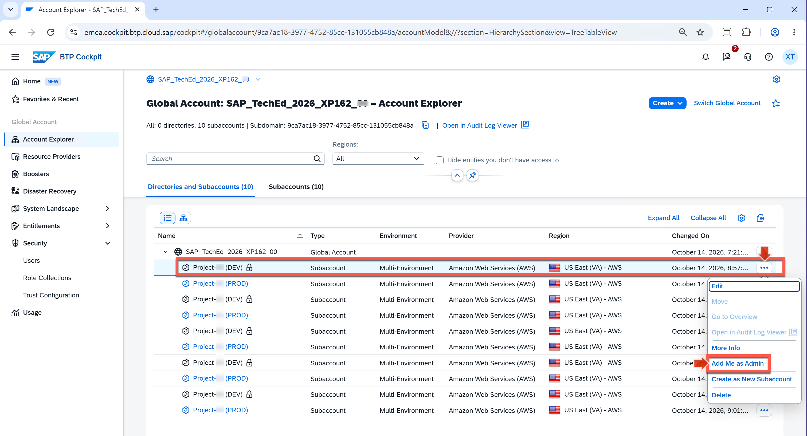

   ✅ **Expected Result**: The before non-accessible subaccount is now accessible:
   - The lock icon vanished
   - The subaccount name now shows a clickable link

5. Click on the **subaccount link**

6. Select **`Security > Users`** menu

   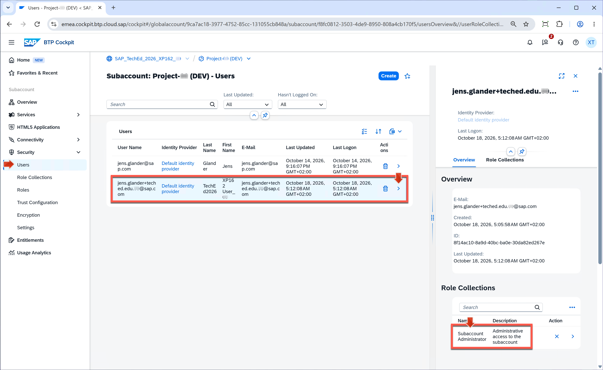

   ✅ **Expected Result**: Your test user can now navigate into the previously non-accessible subaccount.

   **What happened:**
   - The `Add me as Admin` action added your user `jens.glander+teched.edu.<NN>@sap.com` to the subaccount users
   - It assigned your user the **`Subaccount Administrator`** role collection
   - Additionally, you can see there is one other user `jens.glander@sap.com` who also has the `Subaccount Administrator` role collection assigned

> 💡 **Insight**: As Subaccount Administrator, your user can now explore more details of this subaccount. By assigning yourself to the other subaccounts, you could do this for all the other yet non-accessible subaccounts.

> ⚠️ **Note**: But again, retrieving standard administrative tasks information by using BTP Cockpit is not very efficient due to the many required actions and navigation steps.

---

## 5. Assign Service Quota, Create Subscription, and Configure Access

This section demonstrates the **complete workflow** for making a new service available to users. We'll use **SAP Business Application Studio** as an example service subscription.

**The Multi-Step Process:**
1. **Assign service plan to a subaccount** (Global Account level)
2. **Create service subscription** (Subaccount level)
3. **Assign user to role collections** (Subaccount level)
4. **Launch the application** (Verify it works)

> 💡 **Preview**: In Exercise 4, you'll perform this same workflow using BTP MCP — the entire process will be reduced to 1-2 natural language prompts instead of 20+ manual steps!

---

### 5.1 Assign Service Plan to a Subaccount

**Context**: Service quotas are managed at the Global Account level and assigned (entitled) to specific subaccounts. This is a prerequisite before you can create a subscription.

**Steps on Global Account Level (Entity Assignments page):**

1. Click on **`SAP_TechEd_2026_XP162_<NN>`** global account link in breadcrumb (top-left)

2. Click on **`Entitlements > Entity Assignments`**

3. Click on **`Subaccounts/Directories`** selector

   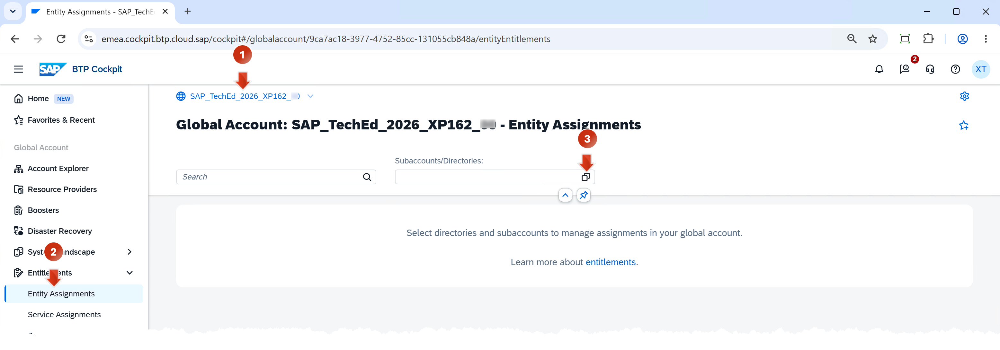

4. Select the subaccount **`Project-<DD> (DEV)`** where you **assigned yourself before as Subaccount Administrator**

5. Press **`Select`**

   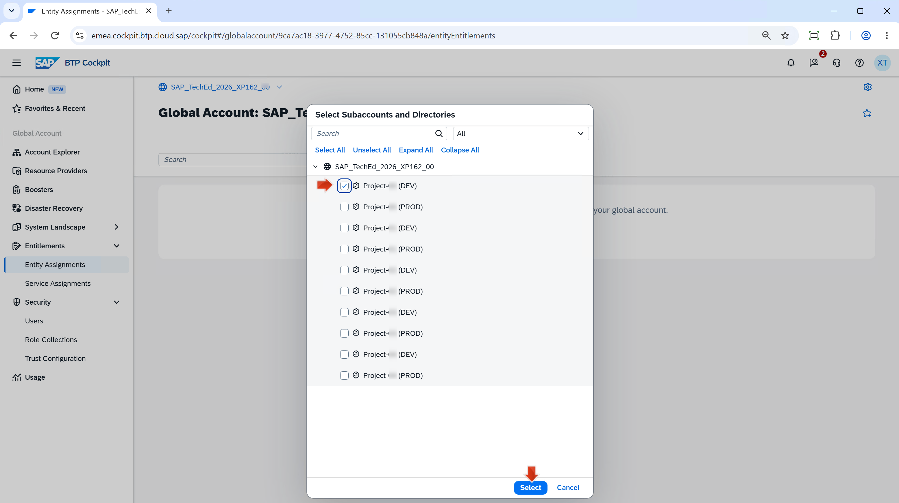

6. Enter **`Business Application Studio`** in Search field

7. Click **`Search`** icon (magnifying glass)

   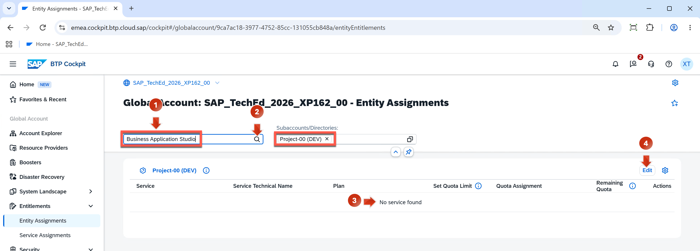

   ✅ **Expected Result**: So far there has not been a `Business Application Studio` service assigned to your selected subaccount `Project-<DD> (DEV)`.

8. Click **`Edit`** (top-right)

9. Click **`Add Service Plan`**

   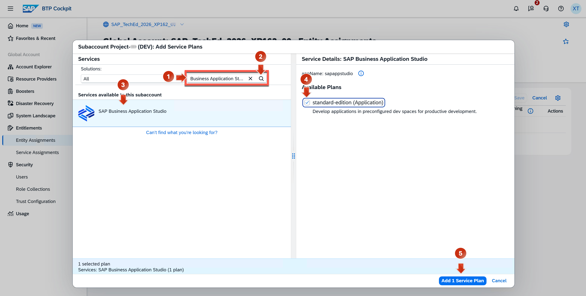

   ✅ **Expected Result**: Add Service plan dialog for `Project-<DD> (DEV)` opens.

10. Enter **`Business Application Studio`** in Search field

11. Click **`search icon`**

12. Select found **`SAP Business Application Studio`** service

13. Select **`standard-edition`** plan

14. Press **`Add 1 Service Plan`**

    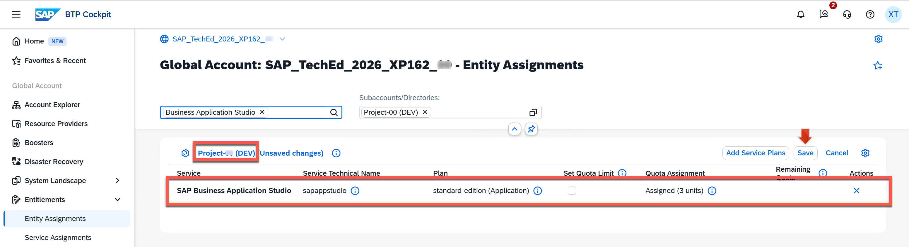

    ✅ **Expected Result**: `SAP Business Application Studio` Service plan `standard-edition` has been added as **`unsaved change`** to subaccount `Project-<DD> (DEV)`.

15. Press **`Save`**

    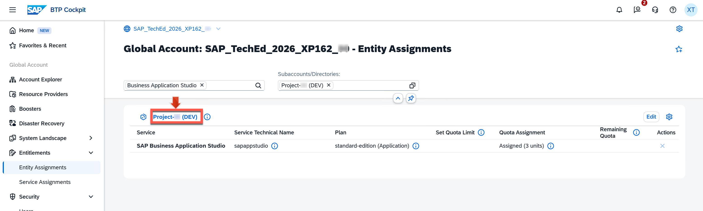

    ✅ **Expected Result**: `SAP Business Application Studio` Service plan `standard-edition` has been **successfully assigned** to subaccount `Project-<DD> (DEV)`.

    **What this means:**
    - Service `SAP Business Application Studio` with plan `standard-edition` is now entitled to be used in this subaccount
    - You can now create a subscription to this service in the subaccount

16. Click on **`Project-<DD> (DEV)`** link to navigate into the respective subaccount Cockpit page where you continue with the next steps in subsection 5.2

> 📊 **Progress Check**: You've completed **step 1 of 4** — the service plan is assigned. Next: Create the actual subscription.

---

### 5.2 Create Service Subscription

**Context**: Now that the service plan is entitled at the Global Account level, you can create an actual subscription at the Subaccount level.

**Steps on Subaccount Level (Instances and Subscriptions page):**

1. Click on **`Instances > Subscriptions`** (left menu)

   ✅ **Expected Result**: Subaccount `Instances and Subscriptions` page opens from where you can create entitled service instances and subscriptions.

   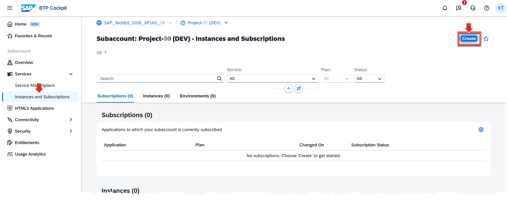

2. Click **`Create`** (top-right)

3. Select Service **`SAP Business Application Studio`**

4. Select Plan **`standard-edition`**

   ✅ **Expected Result**: New Instance or Subscription creation dialog is opened, filled, and ready for creating `SAP Business Application Studio` subscription.

   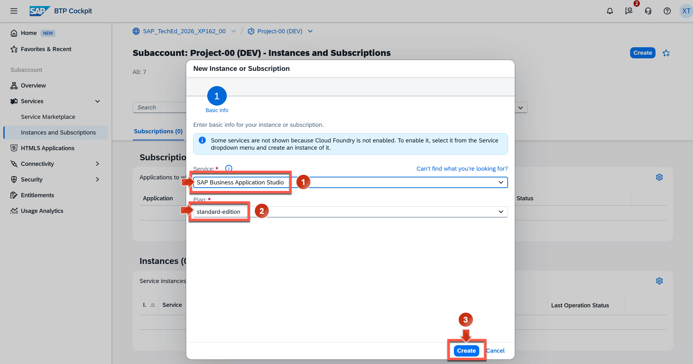

5. Press **`Create`**

   ✅ **Expected Result**: After some time (may take 30-60 seconds), the new `SAP Business Application Studio` subscription is processed and finally shows **Subscription Status: Subscribed**. The subscription detail page opens automatically.

   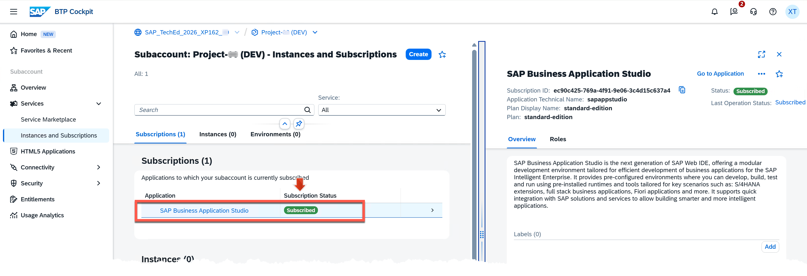

   > ⚠️ **Important**: Before a user can launch and use the SAP Business Application Studio tool for web-based development, **user role assignment** has to be done as described in next subsection 5.3.

> 📊 **Progress Check**: You've completed **step 2 of 4** — the subscription exists. Next: Assign role collections so users can actually use it.

---

### 5.3 Assign User to Role Collections

**Context**: A subscription exists, but users need specific role collections to access and use the application. Without these roles, the "Go to Application" link won't work properly.

**Steps on Subaccount Level (Users page):**

1. Click on **`Security > Users`** (left menu)

2. Select your test user **`jens.glander+teched.edu.<NN>@sap.com`**

3. On the selected user's detail page, click **`...`** icon (top-right) to open `additional options` menu

   ✅ **Expected Result**: Subaccount `Users` page opens and on the selected user's detail page you have opened the `additional options` to continue with assigning additional role collections.

   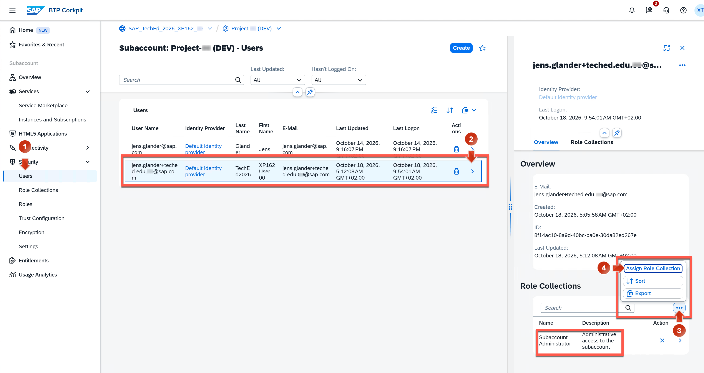

   **Current state:**
   - So far the list of role collections contains only one entry: **`Subaccount Administrator`**, which is the one you assigned yourself before via the `Add me as Admin` action

4. Choose **`Assign Role Collection`** option to open respective dialog

5. Select **all three** Role Collections starting with **`Business_Application_Studio`**:
   - `Business_Application_Studio_Administrator`
   - `Business_Application_Studio_Developer`
   - `Business_Application_Studio_Extension_Deployer`

   ✅ **Expected Result**: `Assign Role Collection` dialog opens with which you can assign the respective three `Business Application Studio` role collections to your user, which enable you then to access the before created subscribed application.

   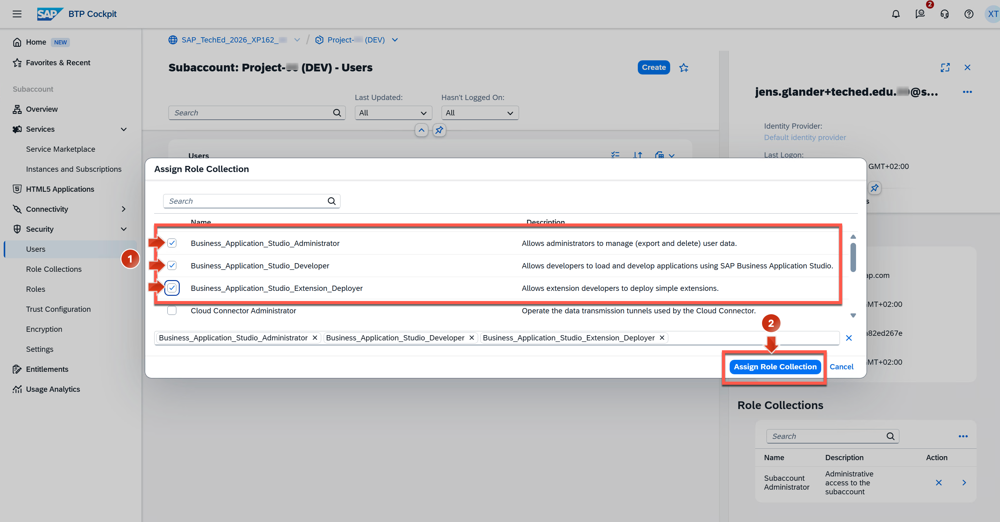

6. Press **`Assign Role Collection`** button

   ✅ **Expected Result**: Three `Business Application Studio` role collections are assigned to your user.

   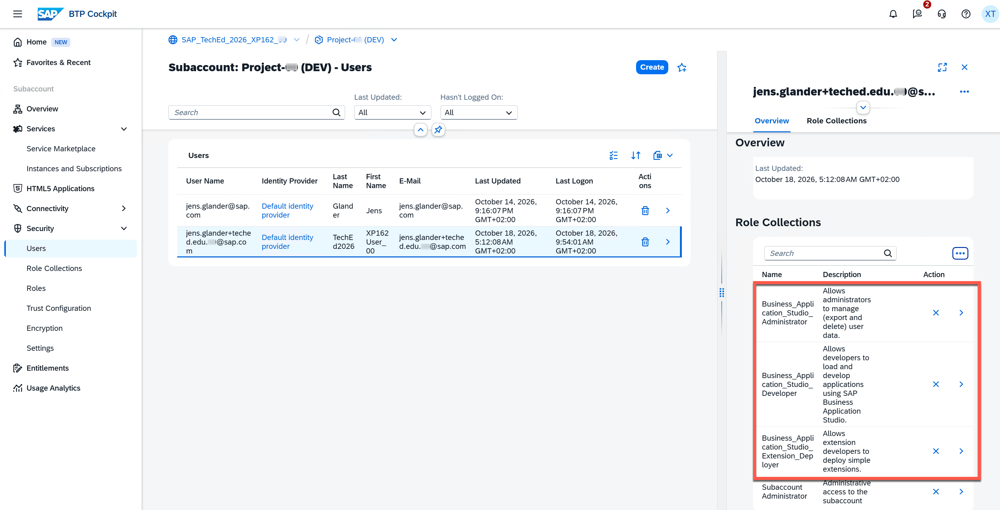

> 📊 **Progress Check**: You've completed **step 3 of 4** — roles are assigned. Next: Launch and verify the application works!

---

### 5.4 Launch Subscribed SAP Business Application Studio Application

**Context**: With the subscription created and roles assigned, you can now launch the application to verify everything works.

**Steps on Subaccount Level (Instances and Subscriptions page):**

1. Click on **`Services > Subscriptions`** (left menu)

2. Select created **`SAP Business Application Studio`** Subscription to open details page

   ✅ **Expected Result**: Details page of subscribed `SAP Business Application Studio` opens where the **`Go to Application`** link is available.

   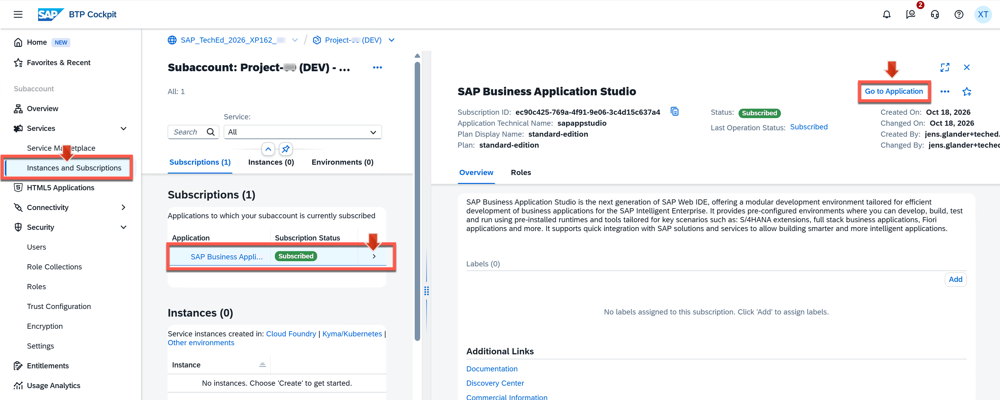

3. Click **`Go to Application`**

   ✅ **Expected Result**: Subscribed Application `SAP Business Application Studio` opens in a new browser tab with your signed-in test user.

   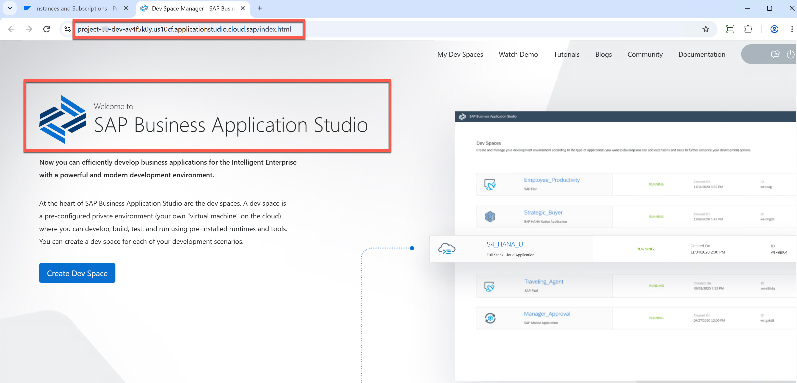

   **Success!** You have successfully:
   - ✅ Assigned a service plan to a subaccount (Global Account level)
   - ✅ Created a service subscription (Subaccount level)
   - ✅ Assigned role collections to your user (Subaccount level)
   - ✅ Launched and verified the application works

> 📊 **Progress Check**: You've completed **all 4 steps** — the full workflow is done!

---

## ✓ Validation Checklist

You have successfully completed this exercise if you can answer:

- [ ] What is your role at the global account level? *(Answer: Global Account Administrator)*
- [ ] How many subaccounts do you have access to initially? *(Answer: 5 accessible, 5 locked)*
- [ ] What action grants you access to a locked subaccount? *(Answer: "Add me as Admin")*
- [ ] How many main steps are required to make a new service available to users? *(Answer: 4 major steps with 20+ individual clicks)*
- [ ] What role collections did you assign for Business Application Studio? *(Answer: 3 role collections)*

---

## Reflection: The Complexity of Administrative Workflows

### What You Just Experienced

**Task**: Make SAP Business Application Studio available to a user

**Time Investment**: ~5 minutes of careful clicking and navigation

**Steps Required**:
1. Global Account level: 16 steps to assign service plan
2. Subaccount level: 5 steps to create subscription
3. Subaccount level: 6 steps to assign role collections
4. Verification: 3 steps to launch application

**Total**: **30+ manual actions** across multiple UI pages and levels

### Common Challenges with This Approach

| Challenge | Impact |
|-----------|--------|
| 🕐 **Time-consuming** | ~5 minutes per subscription setup |
| 📝 **Error-prone** | Easy to miss a step or select wrong option |
| 📚 **Requires documentation** | Hard to remember exact sequence without guide |
| 🔄 **Not reusable** | Must repeat entire process for each service |
| 🚫 **Not scalable** | Imagine doing this for 10 subaccounts, 5 services each |
| 📊 **Hard to audit** | No clear record of what was configured when |

### What's Coming in Exercise 4

In the next exercise, you'll perform **this exact same workflow** using BTP MCP with Claude Code CLI.

**Preview of the transformation:**

```
BTP Cockpit (Exercise 3):
- 30+ manual steps
- ~10+ minutes
- Multiple page navigations
- Error-prone clicking

BTP MCP + Claude Code (Exercise 4):
- 1-2 natural language prompts
- 30-60 seconds
- No navigation required
- Repeatable and auditable
```

**Example prompt you'll use:**
```
   In my subaccount "Project-<DD> (DEV)" create a SAP Business Application Studio subscription by executing the following subsequent steps.

   1. Assign subaccount entitlement for SAP Business Application Studio (sapappstudio, plan standard-edition) service to the subaccount.
   2. ...
   ...
```

That single prompt replaces all 30+ steps you just performed!

---

## Troubleshooting

| Issue | Solution |
|-------|----------|
| Can't login with second test user | Verify you're using the **correct** email format: `jens.glander+teched.edu.<NN>@sap.com` (not the custom IdP user from Exercise 1) |
| "Add me as Admin" option not available | Confirm you're logged in with the Global Account Administrator user, not the viewer user from Exercise 1 |
| Service plan not found | Use exact search term: "Business Application Studio" (case-sensitive) |
| Subscription creation fails | Verify service plan was successfully assigned at Global Account level first |
| "Go to Application" doesn't work | Ensure all 3 role collections are assigned to your user |
| Wrong subaccount selected | Look for `Project-<DD> (DEV)` type, not PROD |

---

## Summary

**What You Accomplished:**

In this exercise, you successfully:
1. **Logged in** with a second test user having Global Account Administrator privileges
2. **Explored** the difference between viewer and administrator capabilities
3. **Granted yourself access** to a previously locked subaccount using "Add me as Admin"
4. **Performed a complete administrative workflow**:
   - Assigned service quota at Global Account level (16 steps)
   - Created service subscription at Subaccount level (5 steps)
   - Assigned role collections to enable user access (6 steps)
   - Verified the application launched successfully (3 steps)

**Key Takeaways:**

✅ **Administrator vs. Viewer**: You experienced firsthand the capabilities unlocked by administrator privileges  
✅ **Workflow Complexity**: A simple task (make a service subscription available) requires 30+ manual steps across multiple levels  
✅ **Time Investment**: Administrative tasks consume significant time even when you know the exact steps  
✅ **Error Potential**: Each step is an opportunity for mistakes (wrong selection, missed checkbox, etc.)  
✅ **Documentation Dependency**: Without a step-by-step guide, this workflow would be hard to execute correctly

**The Challenge:**

While BTP Cockpit provides full capabilities for BTP administration, the **user experience for administrative workflows is suboptimal**:
- Too many clicks
- Too much navigation
- Too much context switching
- Too easy to make mistakes
- Too hard to repeat at scale

**The Solution Ahead:**

In **Exercise 4**, you'll discover how BTP MCP with Claude Code CLI transforms this experience:
- From clicks to conversation
- From manual steps to natural language
- From 5-10 minutes to 1-2 minutes
- From error-prone to reliable
- From one-off actions to reusable patterns

---

**Next**: Continue to [Exercise 4 - Administrative Workflows with BTP MCP](../ex4/README.md) to experience the transformation.

---

**Congratulations!** You've completed Exercise 3 and are now ready to experience AI-powered BTP administration. 🚀
