# Exercise 4: Administrative Workflows with BTP MCP

⏱️ **Estimated time**: 30-35 minutes

## Overview

In Exercise 3, you experienced the complexity of BTP administrative workflows through the Cockpit UI: 30+ manual steps, 5-10 minutes, and multiple navigation levels just to create a single service subscription.

**Now experience the transformation.**

In this exercise, you'll perform the **exact same administrative tasks** using BTP MCP with Claude Code CLI — but instead of clicking through dozens of pages, you'll use **natural language prompts**. What took 5-10 minutes and 30+ steps will now take ~1 minute and a single prompt.

### What You'll Learn

By the end of this exercise, you will:

Part 1: 
- Configure a second BTP MCP using SSO authentication (different from Exercise 2's Basic Auth)

Part 2:
- Perform write operations through natural language prompts
- Execute multi-step administrative workflows automatically
- Compare the efficiency: UI clicks vs. conversational AI
- Verify results in BTP Cockpit to confirm accuracy

### The Transformation at a Glance

| Task | Exercise 3 (Cockpit UI) | Exercise 4 (BTP MCP) |
|------|-------------------------|----------------------|
| **Grant subaccount access** | Navigate → Find subaccount → Actions → Add me as Admin → Confirm | `Add me as Administrator to all locked subaccounts` |
| **Create subscription** | 30+ steps across 3 levels (Global Account → Subaccount → Users) | Single 6-line prompt |
| **Time investment** | ~5 minutes per subscription | ~1 minute |
| **Repeatability** | Must manually repeat for each | Reuse same prompt, change subaccount name |
| **Error potential** | High (many click opportunities) | Low (AI validates parameters) |

---

## Prerequisites

- Completed Exercises 1, 2, and 3
- PowerShell Terminal (Administrator access)
- Visual Studio Code
- Claude Code CLI
- Your second test user credentials from Exercise 3:
  - 📧 **Email**: `jens.glander+teched.xp162.<NN>@sap.com`
  - 🔑 **Password**: `xp162.<NN>...`
  - 🏢 **Identity Provider**: SAP ID Service (default IdP)
  - 👤 **Role**: Global Account Administrator

---

## Learning Objectives

By the end of this exercise, you will be able to:
- Configure multiple BTP MCP connections in a single project (or different projects)
- Authenticate MCP servers using SSO browser-based flow (vs. Basic Auth environment variables)
- Use natural language to perform complex multi-step administrative workflows
- Understand when to use AI agents vs. traditional UI for administrative tasks
- Validate AI-executed operations in BTP Cockpit
- Articulate the business value of conversational BTP administration

---

## Understanding Authentication Modes

You'll configure a **second BTP MCP connection** using a different authentication method:

| Aspect | Exercise 2 MCP | Exercise 4 MCP |
|--------|----------------|----------------|
| **MCP Name** | `mcp-btp-admin-customidp` | `mcp-btp-admin-sapidp` |
| **User** | Custom IdP user | SAP ID Service user |
| **Auth Mode** | **Basic Authentication** | **Single Sign-On (SSO)** |
| **Credentials** | Environment variables | Browser-based OAuth flow |
| **Setup** | Manual base64 encoding | Automated browser login |

> 💡 **Why Two MCPs?** In enterprise scenarios, you might manage multiple BTP landscapes with different identity providers. This exercise demonstrates how to work with both authentication modes.

---
## Part 1: Set Up a Second BTP MCP Project with Claude Code CLI

In Exercise 2, you created a project folder `MyFirstBtpMcpProject` and connected a BTP MCP authenticated with your custom IdP user (`teched.xp162.<NN>@education.cloud.sap`).

Now you'll create a **second project** `MySecondBtpMcpProject` and add a BTP MCP authenticated with your SAP ID Service user (`jens.glander+teched.xp162.<NN>@sap.com`).

> 💡 **Alternative Approach**: You could also add the second MCP to your first project. We're using separate projects here for clarity, but in real scenarios, one project with multiple MCP connections is common.

---

## 1.1 Create Project Directory

1. Click `Start` button on the Windows taskbar and search for `Terminal`

2. Right-mouse click on `Terminal App` and choose **`Run as administrator`**

3. If `User Access Control dialog` opens, confirm with **Yes**

4. Create a folder using command:
   ```powershell
   mkdir MySecondBtpMcpProject
   ```

5. Navigate into the folder:
   ```powershell
   cd MySecondBtpMcpProject
   ```

   ✅ **Expected Result**: You're now in a new, empty project directory.

---

## 1.2 Launch Claude Code CLI

1. Use next command in PowerShell to open Claude Code CLI interface:
   ```powershell
   claude
   ```

2. Press `Enter` ⏎ to confirm *Yes, I trust this folder* (your project folder)

   ✅ **Expected Result**: The Claude Code CLI interface opens and is ready to take your first prompt.

   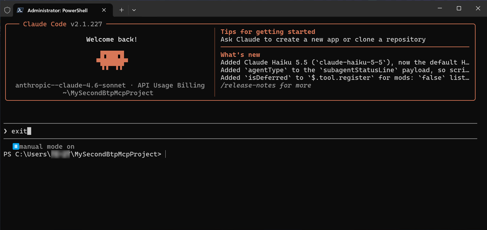

---

## 1.3 Configure the MCP Server

Before you can use the BTP MCP server within Claude Code you need two things:
- **Add the MCP configuration** ("connected" MCP)
- **Authenticate the MCP server** ("authenticated MCP")

The first will be done from the Terminal, the second from Claude Code CLI using a browser-based login flow.

To visualize where the MCP configuration is stored and how it looks, we'll use Visual Studio Code as editor.

### Step 1: Exit Claude and Open VS Code

1. Type `exit` and press `Enter` ⏎ to leave the Claude interface:
   ```
   exit
   ```
   

2. Clean up Terminal output:
   ```powershell
   clear
   ```

3. Open `VS Code editor`:
   ```powershell
   code .
   ```

   ✅ **Expected Result**: `VS Code editor` opens.
   
   Place it next to the `Terminal` window as in the following screenshot.

   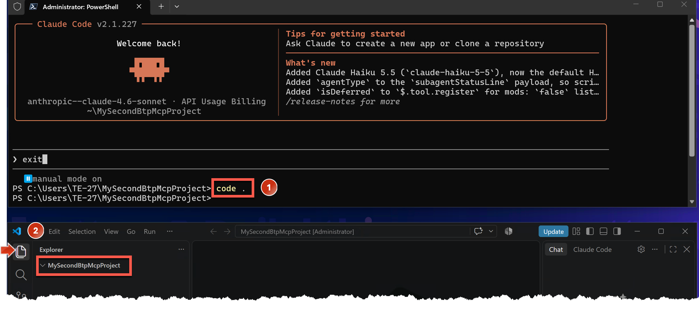

   - The project folder `MySecondBtpMcpProject` displayed in the `Explorer` view is currently empty.

### Step 2: Add BTP MCP Configuration

4. With the next command you add the BTP MCP configuration to Claude Code:

   > 💡 **Reference**: See also SAP Help Portal documentation [Connect to the BTP MCP Server](https://help.sap.com/docs/btp/sap-business-technology-platform/connect-to-mcp-server-for-sap-btp-administration) via Single Sign-On authentication mode.

   ```powershell
   claude mcp add --transport http --scope project mcp-btp-admin-sapidp "https://sso.mcp.btp.cloud.sap/mcp" --client-id e789ba01-5612-47ee-bfe7-79e26411c1ca
   ```

   ✅ **Expected Result**: The BTP MCP Server configuration `mcp-btp-admin-sapidp` was added to a new `.mcp.json` file, visible in VS Code editor.

   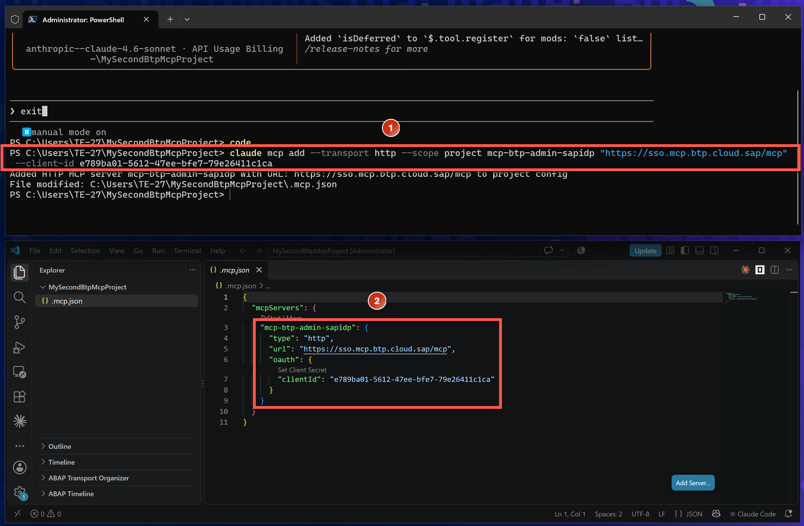

   **Understanding the Configuration:**
   
   The configuration for the BTP MCP `mcp-btp-admin-sapidp` connected to SAP default IdP (with **SSO authentication mode**) looks different than the BTP MCP `mcp-btp-admin-customidp` from Exercise 2 (with **Direct Connection authentication mode**):

   | Field | SSO Mode (This Exercise) | Basic Auth (Exercise 2) |
   |-------|-------------------------|-------------------------|
   | **URL** | `https://sso.mcp.btp.cloud.sap/mcp` | `https://proxy.c-769d49e.kyma.ondemand.com/mcp` |
   | **Credentials** | None (browser OAuth flow) | `Authorization: Basic ${BTP_CREDENTIALS}` header |
   | **Client ID** | Required (`--client-id`) | Not used |
   | **Platform Origin** | Not needed (auto-detected) | `X-Platform-Origin: ${BTP_ORIGIN}` header |

   > 🔐 **Security Note**: The SSO authentication mode does not need credentials in environment variables because authentication is triggered from Claude Code CLI via an opened browser login flow through which the user authenticates the configured BTP MCP.
   
   > 💡 **Future**: Currently this preferred SSO mode works only for SAP default IdP, but support for custom IdP is coming soon.

---

## 1.4 Authenticate BTP MCP in Claude Code

Now that the MCP is configured, you need to authenticate it using your SAP ID Service user.

1. Open Claude Code CLI interface again:
   ```powershell
   claude
   ```

2. Confirm `Use this MCP Server` with Return ⏎

3. In Claude, open the `/mcp` (slash) command to enter the manage configured MCP Servers menu:
   ```
   /mcp
   ```

   > 💡 **Tip**: In Claude Code, Slash key (/) followed by a keyword are Slash Commands which are shortcuts to specific actions, settings changes, etc. `/mcp` enters the menu to manage MCP servers.

   ✅ **Expected Result**: 
   
   The previously configured `mcp-btp-admin-sapidp` MCP server is listed as an MCP server which **needs authentication** (not yet connected).

   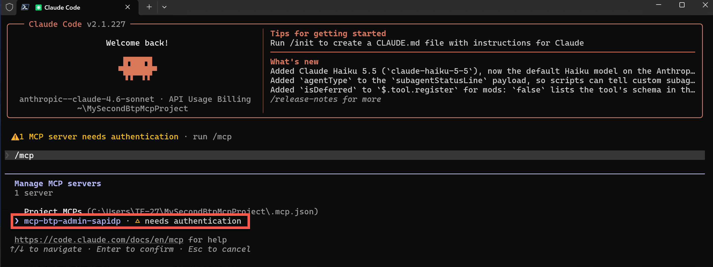

   > 💡 **Navigation Tip**: In Claude Code menus (like the MCP menu), you (1) navigate by arrow up/down keys, (2) confirm a selected item with Return ⏎ key, and (3) use Esc key to go back/cancel.

4. As `mcp-btp-admin-sapidp` MCP server is selected, press Return ⏎ key to get more details and options.

   ✅ **Expected Result**: 
   
   A detail page of `mcp-btp-admin-sapidp` MCP server is displayed showing authentication is required.

   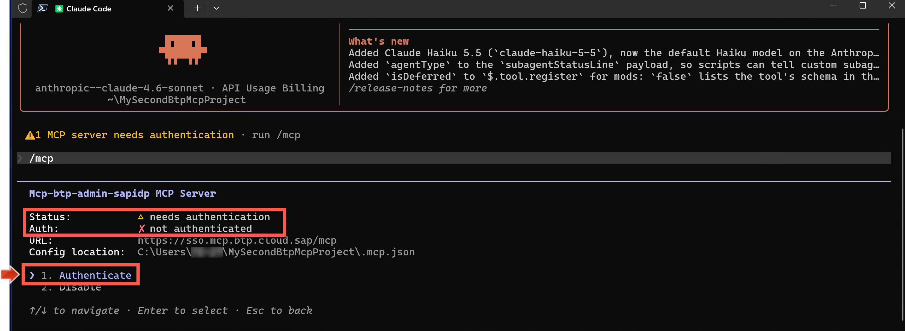

   **The details page shows:**
   - Status: Connected but not authenticated
   - Available action: **Authenticate**

5. Confirm the selected **`Authenticate`** action with `Enter` ⏎

   ✅ **Expected Result**: The authenticate action triggers opening a browser window where a SAP ID `Sign in` logon page appears.

   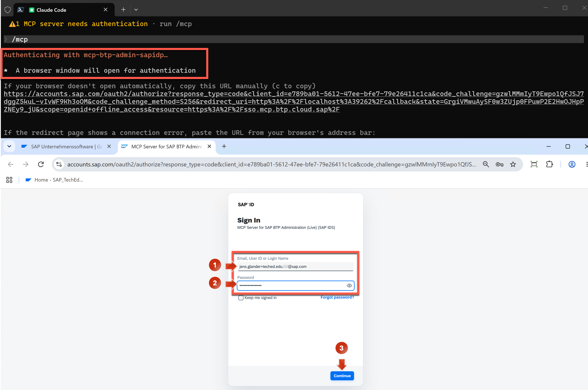

   > 🌐 **What's Happening**: Claude Code launched an OAuth flow that opened your default browser. You'll authenticate there, then the browser redirects back to confirm success.

6. In the browser, enter your test user **email**: `jens.glander+teched.xp162.<NN>@sap.com`

7. Enter your **password**: `xp162.<NN>...`

8. Press **`Continue`**

   ✅ **Expected Result**: The triggered authentication was successful and the browser shows a success page. Back in Claude Code, the `mcp-btp-admin-sapidp` is now **connected and authenticated** with 58 tools.

   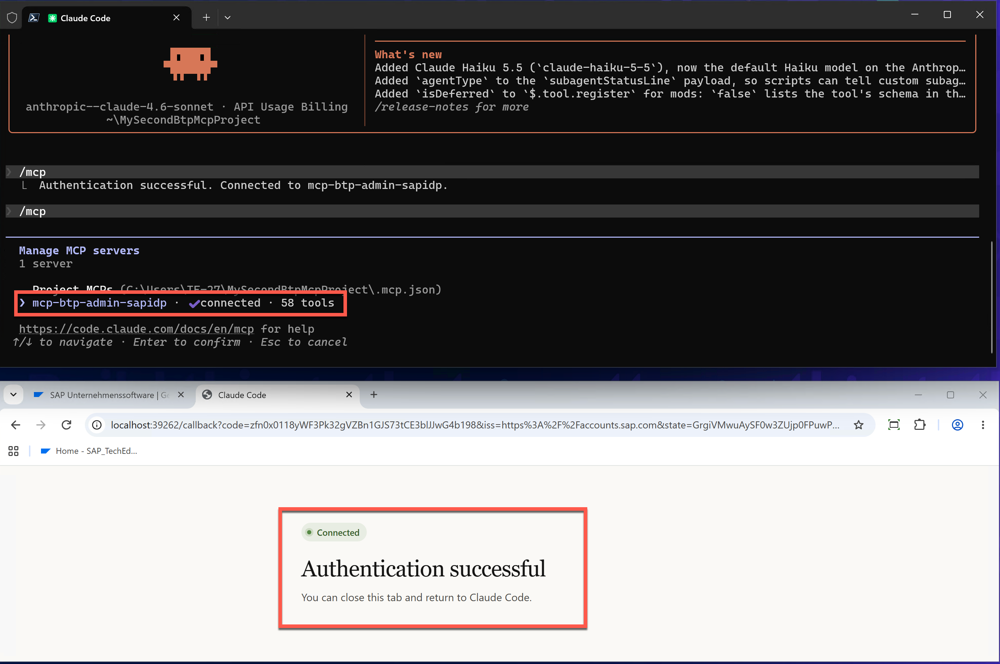

9. In the MCP menu, navigate into the `mcp-btp-admin-sapidp` server details to confirm that **`Auth: authenticated`** is checked.

   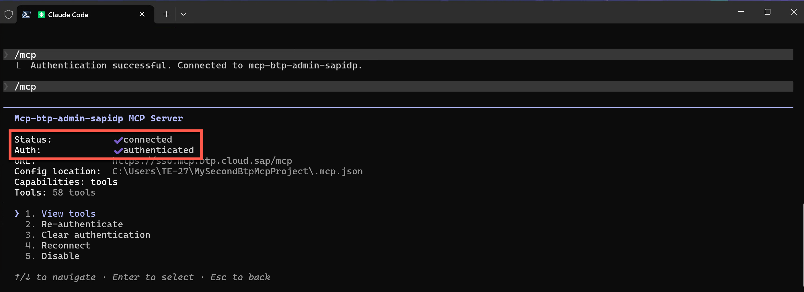

   **Verification checklist:**
   - ✅ Status: Connected
   - ✅ Auth: authenticated
   - ✅ Tools: 58 available

10. Leave the MCP server menu by clicking the `Esc` key several times.

    ✅ **Expected Result**: Claude Code CLI shows "MCP dialog dismissed" and is ready to take a prompt.

    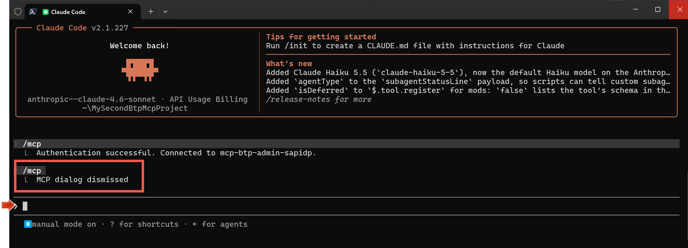

✅ **Checkpoint**: With the above steps you have ensured that your BTP MCP server `mcp-btp-admin-sapidp` is connected and authenticated with your BTP test user from SAP default IdP.

In the following sections, you will explore how this connected BTP MCP enables you to efficiently perform administrative workflows that required many manual steps in Exercise 3.

---

# Part 2: Perform Administrative Tasks with BTP MCP

Now that you have a connected and authenticated BTP MCP server (`mcp-btp-admin-sapidp`), you can start managing your second BTP account with it.

## 2.1 Query 1: Find Your Global Account (Sanity Check)

Before performing write operations, let's confirm that the MCP is connected to the correct global account.

1. Copy the following question and paste it as prompt in Claude Code Interface:
   ```
   Which Global Account I'm assigned to? Give me the Cockpit URL to access it. Output in table format.
   ```

2. Select and confirm **`Yes, and don't ask again...`** option for all MCP tools (which should be only read-only tools like List, Get, Build...)

   ✅ **Expected Result**: The Global Account `SAP_TechEd_2026_XP162_<NN>` (and some details) which your BTP user is assigned to is shown in a table, below the Cockpit URL.

   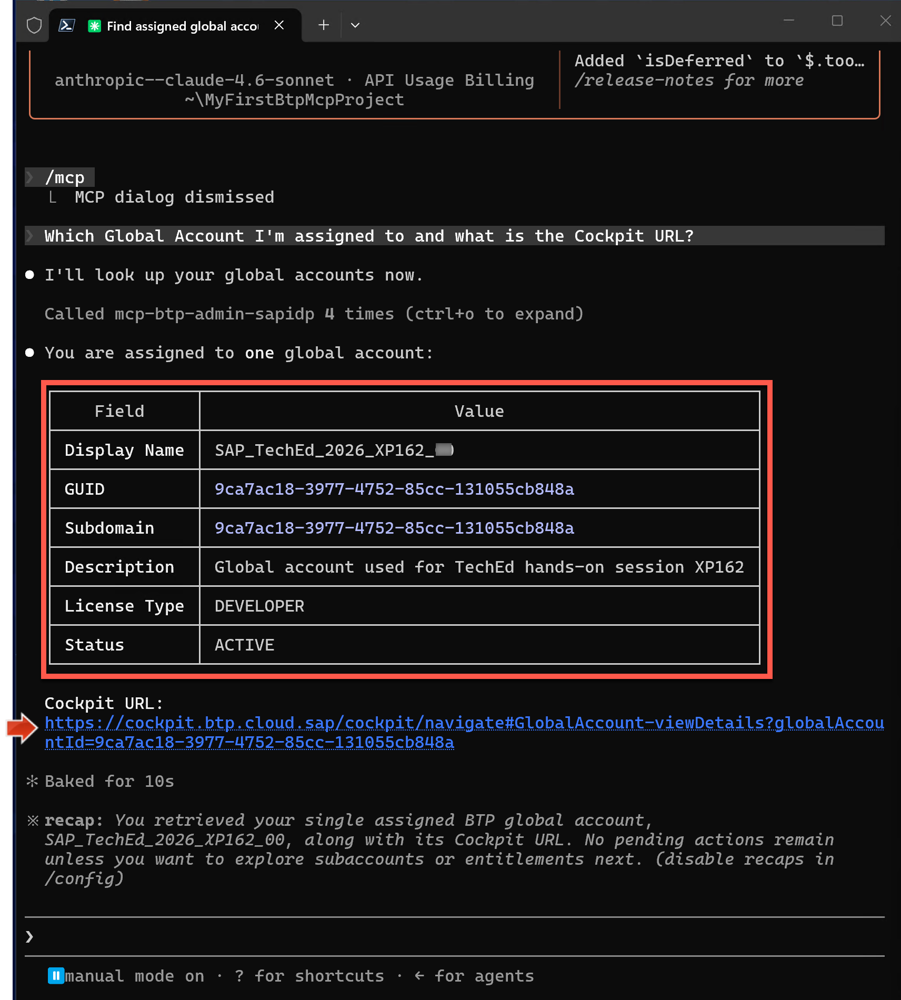

3. Press `CTRL` key and click on the **Cockpit URL link**

4. Sign in with your SAP ID test user and password if required

   ✅ **Expected Result**: The BTP Cockpit opens with the home page of global account `SAP_TechEd_2026_XP162_<NN>`, SAP ID test user `jens.glander+teched.xp162.<NN>@sap.com` is logged in.

   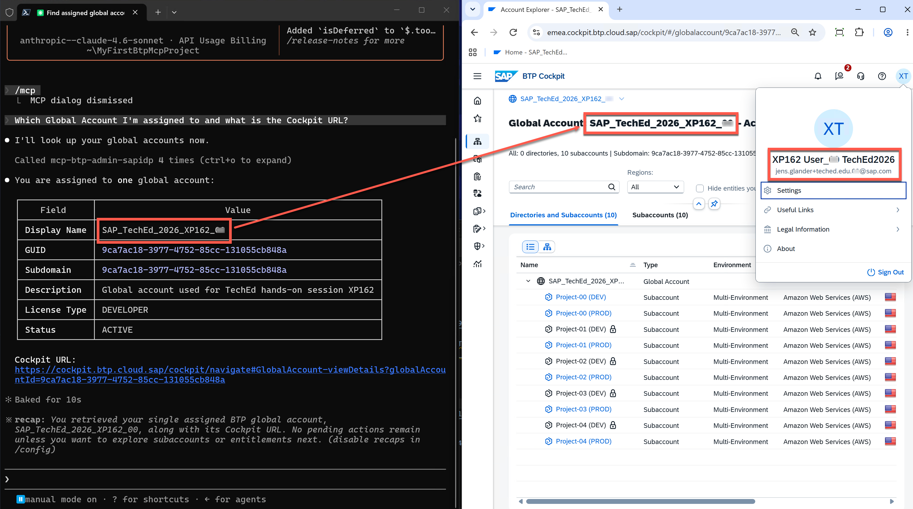

   > 💡 **Setup Tip**: Place the Browser window with the opened Cockpit next to your Claude window as in the screenshot above, so that you can work side-by-side in the following: Results coming from Claude Code can be checked easily if BTP Cockpit is next to it.

### Context from Exercise 3

**Recall from Exercise 3** that your BTP user from SAP default IdP explored and found out via BTP Cockpit:
- User is assigned as **Global Account Administrator** to Global Account `SAP_TechEd_2026_XP162_<NN>`
- User has **5 subaccounts accessible** and **5 subaccounts locked**
- User manually granted himself Subaccount Administrator access to **one** locked subaccount (`Project-00 (DEV)`) using the "Add me as Admin" action

   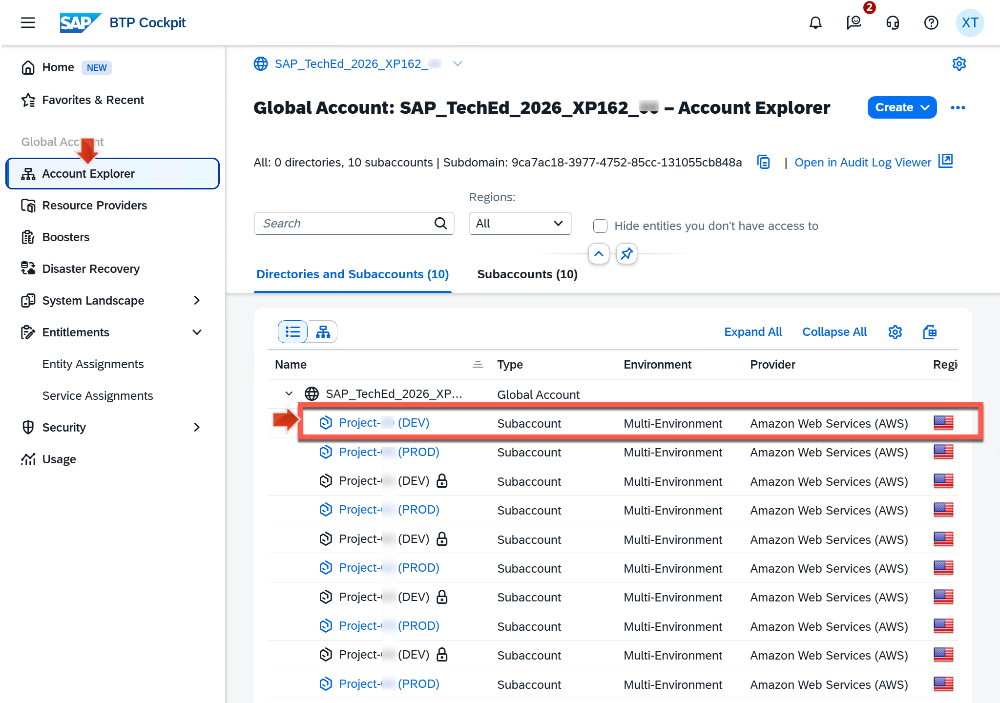

   **Current state:**
   - ✅ `Project-00 (DEV)`: Accessible (you granted access in Exercise 3)
   - 🔒 `Project-01 (DEV)` to `Project-04 (DEV)`: Still locked
   - ✅ `Project-05 (PROD)` to `Project-09 (PROD)`: Accessible (initially)

- In `Project-00 (DEV)`, you went through the multi-step **SAP Business Application Studio subscription creation workflow** (30+ manual steps) so that you could finally launch the subscribed web application.

**Now let's see how these same actions and workflows work via BTP MCP in Claude — and experience the transformation.**

---

## 2.2 Workflow 1: Grant Access to All Locked Subaccounts

**The Challenge from Exercise 3:**
- Manually clicking "..." → "Add me as Admin" → "Assign" for each locked subaccount
- Had to do this one-by-one, navigating through Account Explorer each time

**The BTP MCP Solution:**
- Single natural language prompt
- AI handles all subaccounts in parallel
- Time: ~30 seconds total

---

### Task: Grant Yourself Administrator Access to Remaining Locked Subaccounts

As Global Account Administrator, your user wants to:
1. Grant yourself Subaccount Administrator access to all remaining locked subaccounts
2. Then retrieve information about which users exist in these subaccounts and who is administrator there

### Execute the Workflow

1. Copy the following prompt, replace `<NN>` with yours, and paste it in Claude Code Interface:
   ```
   For all subaccounts my user (jens.glander+teched.xp162.<NN>@sap.com) has no access yet: Use subaccount update tool to add me as Administrator there. Then list which users exist in these subaccounts and who is administrator there.
   ```

   > 💡 **What This Prompt Does**:
   > - Identifies which subaccounts you don't have access to (4 locked DEV subaccounts)
   > - Adds your user as Subaccount Administrator to each one
   > - Lists all users and their roles in those subaccounts
   > 
   > All in one prompt!

2. Select and confirm **`Yes, and don't ask again...`** option for all tools Claude requires to get the action done.

   > ⚠️ **Note**: This time you'll see **write operation tools** like `Update Subaccount`, not just read-only tools. These are the tools that modify BTP resources.

   ✅ **Expected Result**: Based on the prompt, Claude has performed the `Add me as admin` action for all 4 remaining subaccounts **at the same time** and listed the users and subaccount admin information for the previously non-accessible subaccounts.

   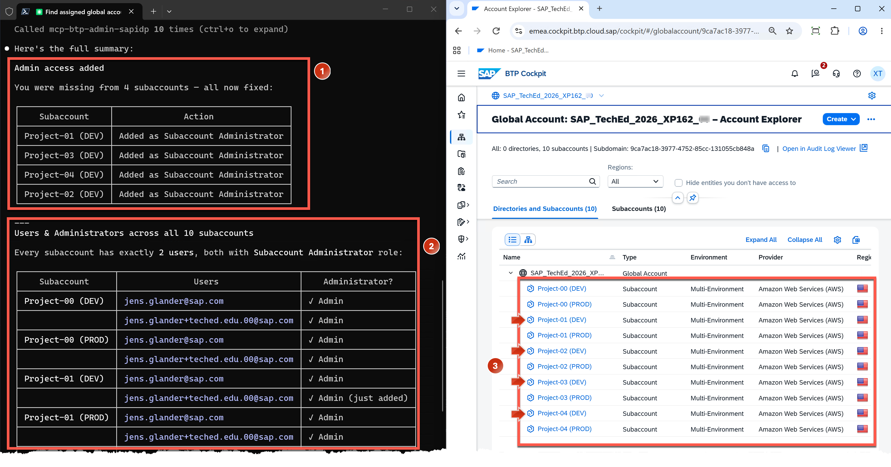

   **What happened (verify in the screenshot):**
   1. ✅ **Your BTP user was assigned to 4 subaccounts as Administrator** (see ① in screenshot)
      - `Project-01 (DEV)`
      - `Project-02 (DEV)`
      - `Project-03 (DEV)`
      - `Project-04 (DEV)`
   
   2. ✅ **List of Users and Subaccount Administrators was provided** (see ② in screenshot)
      - Each subaccount shows which users have access
      - Administrator roles are identified
      - Your user appears in the list with Administrator role
   
   3. ✅ **All subaccounts are now accessible in Cockpit** (see ③ in screenshot, Cockpit page reloaded)
      - No more lock icons
      - All subaccounts now show clickable links

### Verify in BTP Cockpit

3. Switch to your BTP Cockpit browser window

4. Refresh the Account Explorer page (F5)

   ✅ **Expected Result**: All 10 subaccounts are now accessible — no lock icons remain. The 4 previously locked DEV subaccounts now show links.

> ⚡ **Efficiency Comparison**:
> - **Exercise 3 (Manual)**: **~5 minutes**
> - **Exercise 4 (BTP MCP)**:**~1 seconds** for all subaccounts
> 
> **Time saved: 4 minutes (80% reduction)**

---

## 2.3 Workflow 2: Create SAP Business Application Studio Subscription

**The Challenge from Exercise 3:**
In subsections 5.1 to 5.4, you went through a **4-phase, 30+ step workflow**:

1. **Phase 1**: Assign `SAP Business Application Studio` Service Plan to Subaccount (Global Account level) — **16 steps**
2. **Phase 2**: Create `SAP Business Application Studio` Service Subscription (Subaccount level) — **5 steps**
3. **Phase 3**: Assign User to Role Collections (Subaccount level) — **6 steps**
4. **Phase 4**: Test launch the subscribed application (Subaccount level) — **3 steps**

**Total**: 30+ manual actions, 10-15 minutes, 3 different pages/levels

**The BTP MCP Solution:**
- All 4 phases in a **single multi-line prompt**
- AI orchestrates the entire workflow
- Time: 30-60 seconds

---

### Understanding the Workflow Prompt

The following prompt encapsulates the entire subscription creation workflow that required 30+ steps in Exercise 3.

**Key aspects of the prompt:**
- **Explicit step-by-step instructions**: Helps the AI understand the required sequence
- **Wait conditions**: Ensures each step completes before the next begins
- **Service details**: Specific service name (`sapappstudio`) and plan (`standard-edition`)
- **User assignment**: Specifies which role collections and for which user
- **Verification**: Requests a launch link to test

### Execute the Workflow

> [!NOTE]
> Don't forget to replace `<NN>` in the pasted prompt.

1. Copy the following prompt, replace `<NN>` with yours, and paste it **twice** (to expand the multi-line prompt) in Claude Code Interface:

   ```
   In my subaccount "Project-01 (DEV)" create a SAP Business Application Studio subscription by executing the following subsequent steps.

   1. Assign subaccount entitlement for SAP Business Application Studio (sapappstudio, plan standard-edition) service to the subaccount.
   2. Wait until subaccount is entitled to use SAP Business Application Studio
   3. Create a SAP Business Application Studio subscription
   4. Wait until status of created subscription is SUBSCRIBED
   5. Assign all Business Application Studio role collections to user jens.glander+teched.xp162.<NN>@sap.com
   6. Provide a launch link of the subscribed SAP Business Application Studio application
   ```

   > 💡 **Why Paste Twice?**: Claude Code CLI expands multi-line prompts when you paste them a second time. The first paste shows the prompt compressed; the second paste shows it fully formatted.

   > 🎯 **Prompt Design Pattern**: This is a **workflow orchestration prompt**. It:
   > - Lists explicit steps (helps AI understand dependencies)
   > - Includes wait conditions (ensures proper sequencing)
   > - Specifies exact resource names (reduces ambiguity)
   > - Requests verification output (confirms success)

2. Replace `<NN>` in the promt with yours
3. Press return key ⏎ 
4. Select and confirm **`Yes, and don't ask again...`** option for all tools Claude requires to complete the workflow.

   > ⚠️ **Note**: You'll see a mix of tools:
   > - **Write operations**: `Assign Entitlement`, `Create Subscription`, `Assign Role Collection`
   > - **Read operations**: `Get Subscription Status`, `List Role Collections`
   > - **Utility operations**: `Build Navigation Link`

   ✅ **Expected Result**: Based on the prompt, Claude performs the entire `SAP Business Application Studio` subscription creation workflow, usually in **less than 1 minute**.

   **Workflow in Progress:**
   
   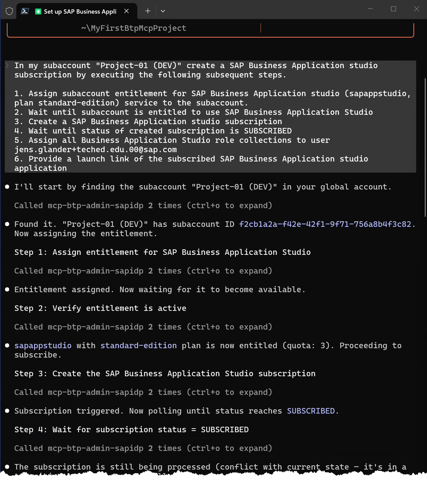

   **What you see while it runs:**
   - Step 1: Assigning entitlement...
   - Step 2: Waiting for entitlement to propagate...
   - Step 3: Creating subscription...
   - Step 4: Waiting for subscription status = SUBSCRIBED...
   - Step 5: Assigning role collections...
   - Step 6: Generating launch link...

   **Workflow Completed:**
   
   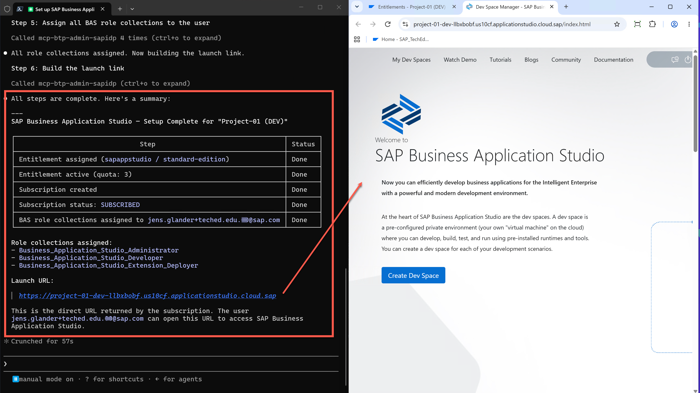

   **Completion summary (verify in screenshot):**
   1. ✅ **Entitlement assigned** to `Project-01 (DEV)` for `SAP Business Application Studio` service plan `standard-edition`
   2. ✅ **Subscription created** with status `SUBSCRIBED`
   3. ✅ **Role collections assigned** to user `jens.glander+teched.xp162.<NN>@sap.com`:
      - `Business_Application_Studio_Administrator`
      - `Business_Application_Studio_Developer`
      - `Business_Application_Studio_Extension_Deployer`
   4. ✅ **Launch link provided**: Click to open SAP Business Application Studio

### Verify in BTP Cockpit

3. Switch to your BTP Cockpit browser window

4. Navigate to `Project-01 (DEV)` → `Services` → `Subscriptions`

   ✅ **Expected Result**: `SAP Business Application Studio` subscription appears with status **Subscribed**.

5. Click on the subscription to see details

   ✅ **Expected Result**: Details page shows:
   - Status: Subscribed
   - Plan: standard-edition
   - "Go to Application" link available

6. Navigate to `Security` → `Users` → Select your user

   ✅ **Expected Result**: Your user shows 4 role collections:
   - Subaccount Administrator (from earlier)
   - Business_Application_Studio_Administrator (just assigned)
   - Business_Application_Studio_Developer (just assigned)
   - Business_Application_Studio_Extension_Deployer (just assigned)

### Test the Application

7. Back in Claude Code window, press `CTRL` and click on the **launch link** provided by Claude

   ✅ **Expected Result**: SAP Business Application Studio opens in a new browser tab with your signed-in test user.

   **Success!** You've completed the entire subscription workflow through conversation.

> ⚡ **Efficiency Comparison**:
> 
> | Metric | Exercise 3 (Manual) | Exercise 4 (BTP MCP) | Improvement |
> |--------|---------------------|----------------------|-------------|
> | **Steps** | 30+ manual actions | 1 prompt | 97% reduction |
> | **Time** | ~5 minutes | ~1 minute | ~80% reduction |
> | **Pages/levels** | 3 (Global Account, Subaccount, Users) | 0 (no navigation) | 100% reduction |
> | **Error potential** | High (30+ click opportunities) | Low (AI validates) | Significant decrease |
> | **Documentation needed** | Step-by-step guide required | Prompt is self-documenting | Reusable prompt |
> | **Repeatability** | Must manually repeat all steps | Copy/paste prompt, change subaccount | Instant reuse |

---

## 2.4 Optional: Try More Workflows

Now that you understand the pattern, try creating more subscriptions or performing other administrative tasks!

### Suggested Experiments

**1. Create another subscription in a different subaccount:**
```
   In my subaccount "Project-02 (DEV)" create a SAP Business Application Studio subscription by executing the following subsequent steps.

   1. Assign subaccount entitlement for SAP Business Application Studio (sapappstudio, plan standard-edition) service to the subaccount.
   2. Wait until subaccount is entitled to use SAP Business Application Studio
   3. Create a SAP Business Application Studio subscription
   4. Wait until status of created subscription is SUBSCRIBED
   5. Assign all Business Application Studio role collections to user jens.glander+teched.xp162.<NN>@sap.com
   6. Provide a launch link of the subscribed SAP Business Application Studio application

```

**2. Create a different service subscription:**
```
What other services are available in my global account that I can subscribe to? List them with their available plans.
```

**3. Manage role collections:**
```
Create a new role collection called "Developer_ReadOnly" in subaccount "Project-01 (DEV)" and assign it to user jens.glander+teched.xp162.<NN>@sap.com
```

**4. Audit your landscape:**
```
For all my accessible subaccounts, list:
- Which subscriptions are active
- Which users have administrator roles
- Which Cloud Foundry environments are configured
```

> 💡 **Tip**: The more specific your prompt, the better the results. Include:
> - Exact subaccount names
> - Specific service names and plan names
> - Wait conditions for asynchronous operations
> - User email addresses for assignments

---

## ✓ Validation Checklist

You have successfully completed this exercise if you can:

- [ ] Configure and authenticate a BTP MCP using SSO mode
- [ ] Understand the difference between Basic Auth and SSO authentication modes
- [ ] Execute a multi-subaccount administrative task with a single prompt
- [ ] Perform a complete subscription creation workflow through conversation
- [ ] Verify AI-executed operations in BTP Cockpit
- [ ] Articulate the efficiency gains: time saved, error reduction, repeatability

---

## Troubleshooting

| Issue | Solution |
|-------|----------|
| SSO authentication fails | Ensure you're using the SAP ID Service user (`jens.glander+teched.xp162.<NN>@sap.com`), not the custom IdP user from Exercise 2 |
| Browser doesn't open during authentication | Check if pop-ups are blocked. Allow pop-ups for `localhost` in browser settings |
| MCP shows "Connected" but not "Authenticated" | Run `/mcp` → Select the MCP → Choose "Authenticate" → Complete browser login |
| Workflow gets stuck at "Waiting for entitlement" | This can take 30-60 seconds. If > 2 minutes, check Cockpit to verify entitlement was assigned |
| "Subscription already exists" error | The subscription may have been created in Exercise 3. Try a different subaccount (e.g., `Project-02 (DEV)`) |
| Role collection assignment fails | Verify the subscription is fully created (status: SUBSCRIBED) before assigning roles |
| Wrong subaccount modified | Always specify exact subaccount name in quotes: `"Project-01 (DEV)"` |
| Claude asks for permission repeatedly | Some tools may not have been added to "don't ask again" list. Check `./.claude/settings.local.json` |

---

## Reflection: The Transformation Experienced

### What You Just Experienced

You performed **two complex administrative workflows** that in Exercise 3 required:
- Workflow 1 (Grant access): 8 minutes of manual clicking
- Workflow 2 (Create subscription): 15 minutes of multi-level navigation

**Total Exercise 3 time**: ~23 minutes of careful, error-prone manual work

**Total Exercise 4 time**: ~2 minutes of conversational interaction
- Type prompt (30 seconds)
- Wait for workflow execution (60 seconds)
- Verify in Cockpit (30 seconds)

**Time saved**: **21 minutes (91% reduction)**

### The Fundamental Shift

| Traditional UI Approach | Conversational AI Approach |
|------------------------|----------------------------|
| 🖱️ **Navigate** through pages | 💬 **Describe** what you want |
| 📝 **Remember** exact click sequence | 🎯 **Specify** desired outcome |
| 🔄 **Repeat** manually for each resource | 📋 **Reuse** prompts with parameters |
| ❌ **Error-prone** (many click points) | ✅ **Validated** (AI checks parameters) |
| 📚 **Requires** documentation | 📝 **Prompts are** documentation |
| ⏱️ **Time per task** | ⏱️ **Time per prompt** |

### Business Impact

**For Individual Administrators:**
- ⚡ 10x faster task completion
- 🎯 Focus on decisions, not clicks
- 📊 More time for strategic work
- 🧠 Reduced cognitive load

**For Organizations:**
- 💰 Reduced operational costs (labor hours saved)
- 📈 Increased consistency (repeatable prompts)
- 🔐 Better auditability (prompt history = action log)
- 🚀 Faster onboarding (natural language > UI training)
- 🔄 Scalable automation (prompts scale to 100s of resources)

### Real-World Use Cases

**Scenario 1: Onboarding New Developer**
- **Before**: 30 minutes to set up access, subscriptions, and roles in 5 subaccounts
- **After**: 5 minutes using reusable prompts per subaccount

**Scenario 2: Quarterly Access Audit**
- **Before**: Full day to manually check users across 50 subaccounts
- **After**: Single prompt retrieves all users, roles, last login dates in 2 minutes

**Scenario 3: Disaster Recovery**
- **Before**: Hours to manually recreate subscriptions and configurations from documentation
- **After**: Run saved prompts to recreate environment in minutes

**Scenario 4: Environment Provisioning**
- **Before**: 2-3 hours to provision DEV/TEST/PROD subaccounts with standard services
- **After**: 10 minutes using parameterized prompts for each environment

---

## Key Takeaways

### Technical Skills Gained

✅ **Multi-MCP Management**: Configure and use multiple MCP servers (different auth modes, different IdPs)  
✅ **SSO Authentication**: Browser-based OAuth flow for MCP authentication  
✅ **Workflow Orchestration**: Design prompts that execute multi-step processes  
✅ **Write Operations**: Perform administrative actions that modify BTP resources  
✅ **Verification**: Validate AI-executed operations in BTP Cockpit

### Strategic Insights

💡 **When to Use AI vs. UI**:
- **Use AI for**: Repetitive tasks, multi-step workflows, cross-subaccount operations, auditing, bulk operations
- **Use UI for**: Exploratory learning, one-off investigations, visual confirmation, complex configurations that need immediate feedback

💡 **Prompt Design Principles**:
- Be specific (exact names, IDs)
- Include wait conditions for async operations
- Request verification output (links, IDs)
- Use numbered steps for multi-phase workflows
- Prompts are documentation — make them readable

💡 **Trust but Verify**:
- Always verify critical operations in Cockpit
- Check the AI's tool usage (what tools it called)
- Review generated links and IDs
- For production use, test prompts in DEV first

### What's Possible Beyond This Session

The BTP MCP capabilities extend far beyond what we covered:

🔮 **Coming Soon**:
- Custom IdP support for SSO authentication
- Additional administrative domains (monitoring, cost management)
- Integration with CI/CD pipelines
- Custom MCP tools for organization-specific workflows

🚀 **Build Your Own**:
- Create organization-specific prompt libraries
- Integrate BTP MCP with other systems via Claude Agent SDK
- Build custom approval workflows
- Generate compliance reports automatically

---

## Summary

**What You Accomplished:**

In this exercise, you successfully:
1. ✅ **Configured a second BTP MCP** using SSO authentication mode
2. ✅ **Performed write operations** through natural language prompts
3. ✅ **Granted subaccount access** to 4 locked subaccounts in one prompt (vs. 8 minutes manually)
4. ✅ **Created a complete subscription** workflow in 60 seconds (vs. 15 minutes manually)
5. ✅ **Verified operations** in BTP Cockpit to confirm accuracy
6. ✅ **Experienced the transformation** from clicks to conversation

**The Numbers:**
- ⏱️ **Time saved**: 21 minutes (91% reduction)
- 🖱️ **Clicks eliminated**: 50+ manual actions
- 📄 **Pages navigated**: 0 vs. 10+
- 🎯 **Efficiency gain**: 10-15x faster

**The Transformation:**
You experienced firsthand how conversational AI with BTP MCP fundamentally changes BTP administration:
- From **manual navigation** to **natural language description**
- From **sequential clicking** to **parallel execution**
- From **error-prone repetition** to **reliable automation**
- From **undocumented tribal knowledge** to **self-documenting prompts**

---

## What's Next?

### Continue Your Journey

1. **Practice with your own BTP accounts** (with proper authorization):
   - Start with read-only queries
   - Move to low-risk write operations in DEV environments
   - Build your organization's prompt library

2. **Explore other MCP servers**:
   - MCP Server for SAP HANA Cloud
   - MCP Server for SAP Help Portal
   - Build custom MCP servers for your systems

3. **Join the community**:
   - SAP Community: Share your use cases
   - GitHub: Contribute examples
   - Your team: Evangelize the approach

4. **Integrate into workflows**:
   - Embed prompts in runbooks
   - Add BTP MCP to CI/CD pipelines
   - Create custom Claude agents for your organization

---

## Feedback & Support

Your feedback helps improve BTP MCP and future training!

📧 **Session Feedback**: [Provide feedback after completion]  
💬 **Questions**: Ask session facilitators  
📚 **Resources**: [Session materials download link]  
🐛 **Issues**: Report to session facilitators

---

**Congratulations!** 🎉

You've completed all exercises and experienced the future of BTP administration:

✅ **Exercise 1**: Baseline — Understanding BTP Cockpit limitations  
✅ **Exercise 2**: First steps — Read-only queries with BTP MCP  
✅ **Exercise 3**: Complexity — Multi-step administrative workflows in UI  
✅ **Exercise 4**: Transformation — Conversational BTP administration

**You're now ready to bring conversational AI to your BTP administration workflows!** 🚀

---

**TechEd 2026 | Session XP162**  
*Beyond the Cockpit: Manage BTP Through Conversation with AI Agents*

© 2026 SAP SE. All rights reserved.
